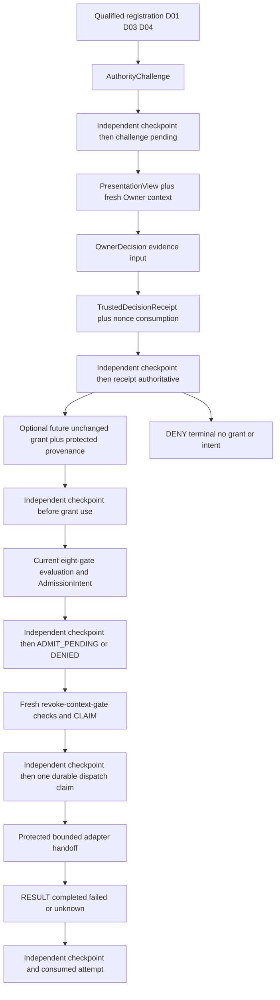

# Nexus G3 U1 D05 production authority contracts v1

Date: 2026-10-08. Phase: specification / contract design only.
Reviewed source checkpoint: `571bfc872873cb361361ab2c66ed59e591067ac1`
on `nexus-v2-g3-development`.

```text
D05_PRODUCTION_DECISION_SEAM = DEFINED
PRODUCTION_CONTRACT_FAMILY = NEXUS_G3_PRODUCTION_AUTHORITY_V1
PRODUCTION_CONTRACT_COUNT = 7
AUTHORITY_CHALLENGE_CONTRACT = AUTHORITY_CHALLENGE_V1_DEFINED
OWNER_DECISION_CONTRACT = OWNER_DECISION_V1_EVIDENCE_ONLY_DEFINED
TRUSTED_RECEIPT_CONTRACT = TRUSTED_DECISION_RECEIPT_V1_DEFINED
PRODUCTION_ELIGIBILITY_CONTRACT = MERGED_INTO_ADMISSION_INTENT_V1
ADMISSION_INTENT_CONTRACT = ADMISSION_INTENT_V1_TYPED_EVALUATION_AND_INTENT_DEFINED
DISPATCH_ATTEMPT_CONTRACT = DISPATCH_ATTEMPT_V1_CLAIM_RESULT_VARIANTS_DEFINED
RECOVERY_CHECKPOINT_CONTRACT = RECOVERY_CHECKPOINT_V1_DEFINED
EXISTING_V1_BODIES_CHANGED = NO
FIXTURE_TO_PRODUCTION_PATH = NONE
COPIED_RECORD_BEARER_AUTHORITY = NO
D05_IMPLEMENTATION_READY = NO
U1_IMPLEMENTATION_CANDIDATE_READY = NO
```

Define seven separately versioned outer metadata record types. Merge production
eligibility and intent into one transactionally created typed record. No separate
positive eligibility document is handed to an executor. Protected N01 state and
a fresh serialized dispatch claim remain the only proposed execution authority.
No record, endpoint, schema parser, ledger, grant or real admission is implemented
or instantiated by this phase. DEFINED describes the contract specification;
deployed provenance, D01/D03/D04 qualification and implementation readiness remain
unproven. Existing native Host approval remains BLOCKED.

## 1. Inputs, scope and record minimization

Authoritative inputs are the accepted
[minimal authority architecture](nexus-g3-u1-minimal-authority-architecture-v1.md),
[Option C qualification](nexus-g3-u1-option-c-deployment-qualification-v1.md),
[D02 Host qualification](nexus-g3-u1-d02-host-confirmation-qualification-v1.md),
[N02 architecture amendment](nexus-g3-u1-n02-minimal-confirmation-architecture-amendment-v1.md),
[authorization contracts](nexus-g3-authorization-contracts-v1.md),
[bridge contract](nexus-g3-host-approval-bridge-contract-v1.md) and current
[authorization](../ash/g3_authorization.py)/[bridge](../ash/g3_host_approval_bridge.py)
source. These remain byte-unchanged.

Only outer provenance, context, challenge, presentation, receipt, evaluation,
intent, attempt and checkpoint metadata are specified. Existing G3 bodies remain
immutable embedded values or exact references. No general IAM, policy DSL,
approval queue, transferable signed grant, new PKI, OAuth provider, workflow
engine or generic evidence service is added.

| Candidate record | Classification | Decision and reason |
|---|---|---|
| AuthorityChallengeV1 | REQUIRED | Freezes exact proposal and one-use nonce before authenticated display; independent of later browser view. |
| PresentationViewV1 | REQUIRED | Binds subsequent verified Owner context and protected render revision to that challenge; refresh/replacement has a separate lifecycle. Merging into immutable pre-login challenge would require mutation or premature session assertions. |
| OwnerDecisionV1 | REQUIRED | Minimal N02-origin evidence input. Keep its untrusted-as-bytes status separate from N01 acceptance/provenance. |
| TrustedDecisionReceiptV1 | REQUIRED | N01's validated terminal decision plus consumption/provenance; not a browser input or grant. |
| ProductionEligibilityDecisionV1 | MERGEABLE | Merge into AdmissionIntentV1, including a DENIED variant. Eliminate a separate positive-to-intent time-of-check interval and record handoff. No standalone schema allocated. |
| AdmissionIntentV1 | REQUIRED | One immutable current evaluation with either no dispatch intent or one ADMIT_PENDING intent. Claim still re-evaluates current state. |
| DispatchAttemptV1 | REQUIRED | Separate irreversible claim and later observed result, with one attempt key; survives uncertain external outcome. |
| RecoveryCheckpointV1 | REQUIRED | Independent recovery custody and ordered durable transition evidence cannot be replaced by a restored ledger record. |
| Generic approval session/history/queue/policy or signed bearer record | NOT_NEEDED | Existing protected state and bounded sessions suffice; no additional record family. |
| Production activation / live issuer, fence and exclusion proof | BLOCKED | Design does not qualify D01/D03/D04 or permit an implementation. |

Count **7** includes N02's evidence-only decision and the ephemeral view; it is
not just a count of durable authoritative types. DispatchAttempt's CLAIM/RESULT
and AdmissionIntent's DENIED/ADMIT_PENDING are closed variants of their respective
schemas, not hidden additional schemas. The nested value shapes below have no
standalone record lifecycle or authority. Transport forms/session cookies are
not additional production authority record types.

## 2. Shared canonical rules and exact nested values

### 2.1 Canonicalization, types and domains

Every new body is a closed JSON object, maximum 65,536 canonical UTF-8 bytes,
depth 12, 16,000 nodes and 64 members per object/array. Reject duplicate keys,
unknown fields, unknown schema versions, invalid UTF-8/BOM, non-NFC strings/keys,
floats, negatives, NaN, unsafe controls, cycles and non-JSON concrete types.
No booleans occur in the new closed bodies. No parsed value implies trusted origin.

Reuse the existing strict integer/UTF-8/canonical JSON semantics: sorted object
keys, compact separators, non-ASCII UTF-8, no whitespace/newline in the canonical
body. Do not silently normalize material strings or change existing canonical
helpers. Ordinary strings are at most 512 characters; opaque tokens use the
existing `[a-z0-9][a-z0-9._:-]{0,95}` syntax (maximum 96 characters). Typed record
IDs are bounded separately to 128, SHA-256/nonce strings to exactly
64 lowercase hex characters. Explicit new outer-only exceptions are described
below; they do not change v1 validation. Booleans are not integers.

All time fields named `_ms` are nonnegative Unix milliseconds, integer through
`2^63-1`. Generations/epochs are integers >=1; sequences are integers >=0. Expiry
is exclusive: `issued_at_ms <= now_ms < expires_at_ms`. Arithmetic overflow denies.
Trusted wall-time high-water and monotonic elapsed time govern validity; executor
or browser time never does. Clock regression or unqualified time is QUARANTINE.

Let `C(x)` denote these canonical bytes. For an explicit domain `d`:

```text
H_d(x) = lowercase_hex(SHA256(UTF8(d) || one_NUL_byte || C(x)))
record_id = d || ":" || H_d(body)
body_sha256 = lowercase_hex(SHA256(C(body)))
```

Each accepted record's `schema_version` equals its domain below. Derived ID and
plain body hash are outside its body. Require typed exact domains at every
reference; recompute both. Do not accept a digest with a different prefix, use
plain hash as a typed ID, or reuse existing `nexus.g3.*.v1`/Slice 3C domains.
Within the assumed SHA-256 collision resistance, separate domains and complete
material binding prevent cross-type confusion. This supplies integrity, not
authentication, signatures or bearer authority.

Set-valued operations/task classes/revocation references/record references are
unique, sorted by exact value or ID. Preserve order in invocation and target
material wherever the qualified target/payload contract says it is meaningful;
never reorder positional arguments or execution order as a cosmetic change.
All fields listed for a body/variant are required unless explicitly optional.
No absent/null equivalence or permissive `_meta`/extensions object is implied.

### 2.2 Exact shared value definitions

These are inline values, not independently issuable records. Their objects reject
unknown keys. References require protected resolution before any positive use.

| Value | Exact fields and constraints |
|---|---|
| `RecordRef` | `{id, body_sha256}`. Typed ID allowed only for the field's named record kind; plain canonical body digest, not ID suffix. |
| `EvidenceRef` | `{ref, sha256}`. Existing reference-token shape, maximum 96 characters; resolves only through fixed qualified N01 sources/ledger, never executor-selected URL or dynamic schema. No secret/token contents. |
| `Principal` | `{issuer, client_id, subject}`. Nonempty NFC strings <=512, exact verified issuer/client/stable subject; never email/name substitution. |
| `Stamp` | `{authority_instance, authority_epoch, incarnation, base_recovery_sequence, base_checkpoint}`. Instance and incarnation are opaque tokens; `authority_epoch` is an integer >=1; sequence is an integer >=0; `base_checkpoint` is a non-null RecoveryCheckpoint RecordRef already independently durable at creation/observation. |
| `Binding` | `{owner, owner_generation, workspace_id, project_id, binding_id, binding_generation}`. Owner is Principal; generations >=1; remaining fields tokens. Protected registration resolves exact project/environment, not strings in a checkout. |
| `OwnerContext` | `{context_id, context_generation, authenticated_at_ms, context_expires_at_ms, identity_evidence, session_evidence}`. Token ID, generation >=1, qualified D01/active-session EvidenceRefs; current principal must equal Binding.owner; validity positive and bounded by the challenge. No credentials or session cookie. |
| `JsonEvidence` | `{contract_ref, contract_sha256, canonical_utf8, content_sha256, source_evidence}`. Contract reference token and digest; content is exact canonical JSON text, at most 16,384 UTF-8 bytes, with inner strict graph limits and fields validated by the separately qualified fixed contract for this Subject. `content_sha256=SHA256(UTF8(canonical_utf8))`; source is EvidenceRef. No opaque unvalidated payload admission. |
| `Material` | `{subject, subject_id, scope, scope_sha256, requested_action, operations, targets, effect_summary, effect_explanation, dispatch_payload, dispatch_material_sha256, source_evidence}`. See exact joins below. Explanation <=4,096 UTF-8 bytes of escaped plain text; source evidence array 1..8, unique/sorted refs. |
| `GateFact` | `{kind, verdict, observed_at_ms, valid_until_ms, source_evidence}`. Fixed kind below; verdict PASS/FAIL/UNKNOWN; `observed_at_ms < valid_until_ms`; evidence from the qualified source. Qualified validity covers the whole exact invocation and current context. |
| `RevocationRead` | `{grant, index_generation, read_at_ms, revocations}`. Grant RecordRef, generation >=1, array 0..64 of exact unchanged Revocation RecordRefs, sorted/unique; completeness comes from the protected authoritative index and current serialized query, not this array itself. |

Material embeds the **unchanged canonical Subject body**, without display title,
and recomputes its existing subject ID. The Subject ID suffix remains its
domain-separated digest, not plain Subject body SHA-256. Scope is the existing
closed normalized scope, with a required exact `task_id` for this production
minimum. `scope_sha256=SHA256(C(scope))`. Use exact scope equality at use; no unions,
broader coverage or wildcard. Require exact account context for account-dependent
Subject/payload. Subject action equals requested_action. Operations are the same
sorted set as scope operations, restricted to `read/write/execute/network/delegate`.

Targets and dispatch_payload are JsonEvidence. The former contains **full**
qualified targets, the latter the full frozen invocation/enforcement payload,
including every material executable/config/argument/environment mapping. Their
fixed contract must be approved for that Subject and independently enforceable.
Missing/unqualified target or payload contract is DENY; the record format is not
a generic policy interpreter. No new target codec is invented from executor data.
Oversize material denies; do not truncate, introduce indirection to mutable bytes,
or silently expand bounds. Full bytes must remain retained and displayable.

`effect_summary` is the existing exact `{operations,targets_sha256}` value, with
targets digest equal to targets.content_sha256. The explanation is separately
bound outer presentation evidence, not an added v1 effect-summary field.
`dispatch_material_sha256=H_nexus.g3.production.dispatch-material.v1(dispatch_payload)`.

A direct proposal ID is
`nexus.g3.production.proposal-material.v1:H_nexus.g3.production.proposal-material.v1(Material)`.
This is an inline material identity, **not an eighth record schema** or a Host
proposal ID. An optional genuine HostApprovalProposal may be embedded only where
its native action is real and its Subject/scope/action/targets exactly match;
its existing body/ID are preserved. Do not manufacture a dummy native command.

Exactly eight GateFacts are present in a fixed kind order:
`D01_IDENTITY_CONTEXT`, `D03_RECOVERY_FRESHNESS`, `D04_EXECUTOR_EXCLUSION`,
`TECHNICAL`, `TASK`, `HOST`, `G1`, `G2`. No caller booleans, missing fact, generic
project permission or evidence from an unqualified source can satisfy a gate.
PASS shape is not proof; N01 verifies provenance and current state itself.
RevocationRead resolves only N01-provenanced retained revocation bodies and the
complete protected index. An executor-supplied revocation is neither accepted as
authority nor silently treated as a complete index. Missing/ambiguous issuer,
clock basis, provenance or index completeness is DENY/QUARANTINE, never absence
of revocation. Effective revocations and protected retirement tombstones dominate
all earlier positive facts.

### 2.3 Checkpoint references, immutable state and cycle avoidance

Stamp.base_checkpoint refers to an **earlier already durable** checkpoint, not
the checkpoint that will include the new record. The subsequent checkpoint binds
the new record IDs/hashes. This avoids a self-reference hash cycle. An old base
does not invalidate historical evidence by itself; its chain/provenance must be
verified, and every current binding/context/expiry/revocation/gate is rechecked.
A stale positive readback never skips those checks.

Immutable records do not change status in place. N01's protected indexes maintain
pending/current-view/consumed/retired/claimed state and immutable tombstones, covered
by checkpoints. Indexes cannot be restored/reset/edited by the executor. CLAIM
and RESULT are distinct immutable DispatchAttempt variants for one attempt key.

## 3. Shared failures, ordering and provenance requirements

DENY rejects input/use with no positive authority. RETIRE closes an authentic
pending/context/grant/intent and never reopens it. QUARANTINE closes the authority
instance on uncertain durable state, rollback, fence/fork or trusted-time failure.
UNKNOWN records an indeterminate observation/acknowledgment/effect outcome and
always denies release/retry. These are outcomes, not alternate approval modes.
Diagnostic output uses bounded reason codes, never input values or credentials.

Closed reason vocabulary for new outcome metadata:
`INVALID_INPUT`, `VERSION_REJECTED`, `ORIGIN_UNVERIFIED`, `BINDING_STALE`,
`CONTEXT_STALE`, `EXPIRED`, `MATERIAL_MISMATCH`, `NONCE_CONSUMED`, `OWNER_DENIED`,
`GRANT_UNTRUSTED`, `GRANT_REVOKED`, `GATE_FAILED`, `GATE_UNKNOWN`, `STATE_STALE`,
`FENCE_UNCERTAIN`, `RECOVERY_MISMATCH`, `ALREADY_CLAIMED`, `OUTCOME_UNKNOWN`,
`CONFIRMED`, `INTENT_PENDING`, `CLAIMED`, `COMPLETED`, `FAILED`, `RETIRED`.
Only enums explicitly allowed in a record's body may occur there. Unknown reason
codes deny; no old v1 reason list is extended.

| Source | What it can authoritatively contribute | What cannot substitute |
|---|---|---|
| Qualified D01 | Verified principal, fresh authentication/context and loss evidence | Email/name, account hint, old login, parsed JWT without current lifecycle proof. |
| Protected N01 | Registration, frozen bytes, nonce/time, generations, state indexes, receipt/grant provenance, serialization, claims/checkpoints | Executor timestamps, flags, schema selectors, copied ledger or matching hash alone. |
| Qualified protected N02 | Exact registered view, explicit current Owner CONFIRM/DENY, protected request/gesture/context evidence | Ordinary POST/Origin header, fabricated OwnerDecision JSON, chat/native accept/auto-review. |
| Qualified existing technical/task/Host/G1/G2 sources | Current scoped facts and enforcement material | Executor-supplied PASS/True or a self-reported successful test. |
| Executor | Candidate Subject/scope/target/payload and proposal locator/status requests only as UNTRUSTED input | Receipt/decision/nonce/store/fence/claim write or Owner/session impersonation. |

Current identity loss, Owner replacement, workspace/project switch or binding
generation change RETIRE dependent pending challenges/views/contexts/grants and
unclaimed intents. Unknown lifecycle coverage is DENY, not a TTL-based positive
fallback. Restart/epoch/incarnation change retires pending confirmations,
pre-restart grants and unclaimed intents, retaining consumption/revocation history.
Recovery never selects the old checkpoint that happens to match a restored table.

| Revocation ordering | Exact proposed behavior |
|---|---|
| Revoke before eligibility | Query complete current protected index; produce DENIED evaluation, no claimable intent. |
| Revoke after eligibility but before intent | There is no separated positive eligibility-to-intent interval: evaluate and create ADMIT_PENDING in one serialized transaction. If revoke wins ordering first, DENIED; if later, retire the unclaimed intent. |
| Revoke after intent but before dispatch claim | Recheck current revocation/context inside claim serialization; RETIRE intent, no CLAIM. |
| Revoke after dispatch claim | Prevent subsequent claims; cannot promise to undo an already handed-off effect. Preserve claimed/uncertain attempt; no replacement dispatch. |
| Context loss / Owner replacement / binding change | Same serialization/retirement rules, including fresh check at claim. Never rebind old receipt/grant to the new generation. |

Pending revocation/invalidation takes priority over new claims. Serialize through
bounded handoff as required by the accepted architecture. Claim authorization
linearizes only after its durable ledger-plus-fence completion. Database commit
does not provide atomicity with an external provider or instant knowledge of an
unobserved issuer change; missing qualification keeps the seam inactive.

## 4. Accepted record definitions

### R01. AuthorityChallengeV1

**A. PURPOSE** — Authoritative frozen pending challenge in N01 state; not consent.
Only N01 creates it after qualified registration/material verification and current
recovery checks. N02 reads it for presentation; N01 consumes/retire-checks it.

**B. VERSION / DOMAIN SEPARATION** —
`nexus.g3.production.authority-challenge.v1`; ID/hash follow Section 2.1 with this
exact domain. Never accept Host proposal or existing Subject IDs as its ID.

**C. CANONICAL BODY** — Required fields exactly:
`schema_version, stamp, binding, material, proposal_id, nonce, issued_at_ms,
expires_at_ms`. Optional field exactly `host_proposal`, whose value is
`{body, proposal_id}` with the unchanged canonical HostApprovalProposal and
existing typed ID. Optional null is rejected. No other optional fields.
Stamp/Binding/Material use Section 2.2. Nonce is 64 hex digits from >=256 random
bits; expiry is >issuance and at most 300,000 ms later. Context validity, if known,
may only narrow that deadline. Proposal ID is derived from exact Material.

**D. REQUIRED JOINS** — Stamp's instance/epoch/incarnation and independent base;
Binding's current exact Owner/project generations; full Subject/scope/action,
operations, targets and payload; nonce/proposal/expiry. A pre-login challenge
does not assert an authenticated browser session. View adds that required join.

**E. TRUST PROVENANCE** — N01 registration/time/CSPRNG and independently verified
technical material; D01-qualified Owner identity mapping. Candidate executor
material becomes frozen only after qualified source verification, not merely parse.
No N02 decision or native accept participates in creation.

**F. REPLAY / FRESHNESS** — Unique `(instance,epoch,nonce)` index; pending only
after durable checkpoint. Expired, consumed, retired or old-incarnation challenge
cannot be rendered as confirmable or renewed. A new challenge requires new nonce.

**G. REVOCATION / ADMISSION ORDERING** — Binding/context invalidation retires
pending state; existing grant revocation cannot be bypassed by creating this
record. It creates no grant and satisfies no eligibility/claim ordering.

**H. FAILURE SEMANTICS** — Invalid/unqualified material or binding: DENY.
Expiry/context change: RETIRE. Uncertain store/fence/time: QUARANTINE. Unknown
presentation readiness denies; no automatic continuation.

**I. BEARER AUTHORITY** — Copied challenge/nonce/ID has no rights. Authenticated
current Owner and protected pending state are still required.

**J. COMPATIBILITY** — Embeds unchanged Subject/scope/effect values; optional
Host proposal remains offline correlation evidence. No old grant/decision/candidate
is migrated, promoted or modified by challenge creation.

### R02. PresentationViewV1

**A. PURPOSE** — Protected, ephemeral registration of one exact render for an
authenticated Owner, later retained as receipt evidence. N01 creates/registers
it using the qualified N02 render revision/context; N02 displays it and N01
checks current view membership. It is not an approval or independent issuer.

**B. VERSION / DOMAIN SEPARATION** —
`nexus.g3.production.presentation-view.v1`; ID/hash use this exact domain.
Presentation digest uses distinct inline domain
`nexus.g3.production.presentation-material.v1`, never its record ID.

**C. CANONICAL BODY** — Exactly:
`schema_version, stamp, challenge, owner_context, view_key, template_revision,
render_evidence, presentation_sha256, issued_at_ms, expires_at_ms`.
No optional fields. Challenge is typed RecordRef; OwnerContext is current D01
context; view_key is an unpredictable token from >=256 random bits, not a secret
approval token. Template revision is a fixed protected digest; render evidence
is EvidenceRef. Expiry <=challenge/context expiry. Presentation hash is the
domain-separated hash of the exact inline value
`{challenge_body,owner_context,template_revision,expires_at_ms}`. N02 renders all
N02-amendment required elements from this projection, plus its digest.

**D. REQUIRED JOINS** — Complete frozen challenge and exact principal/binding;
current context generation, template revision, targets/effects and view/expiry.
CSRF proof/session cookie stay in protected ephemeral transport state, not body.

**E. TRUST PROVENANCE** — D01 supplies context; N01 verifies/registers it;
qualified N02 supplies protected rendering evidence. No executor text/template,
browser-editable digest or fake render acknowledgment establishes the view.

**F. REPLAY / FRESHNESS** — One active view/challenge per Owner/project in the
minimum, as required by the N02 amendment; replacement retires former challenge
or view rather than leaving another confirmable tab. Ephemeral map membership required in addition to canonical
bytes. Restart/loss/expiry removes it; saved pages cannot restore membership.

**G. REVOCATION / ADMISSION ORDERING** — Current binding/context loss closes
view before any decision/claim. View never overrules grant revocation; claim
must recheck despite a once-correct display.

**H. FAILURE SEMANTICS** — Missing/full-render mismatch or forged membership:
DENY. Stale/expired view: RETIRE. Durable authority uncertainty: QUARANTINE.
Unproven browser exclusion/render coverage: UNKNOWN and no decision acceptance.

**I. BEARER AUTHORITY** — View key, digest, HTML or exported JSON is evidence
only; it cannot replace current protected session/CSRF/view checks.

**J. COMPATIBILITY** — New render projection is outer metadata. No native request
or Subject/body fields are added; no Host event is synthesized for this page.

### R03. OwnerDecisionV1

**A. PURPOSE** — Evidence-only explicit CONFIRM/DENY from protected N02 ingress.
Qualified N02 may construct it after actual authenticated form handling; N01
alone validates/consumes it. Canonical bytes are untrusted until matched to
protected origin/session/view observations. It is never a trusted receipt itself.

**B. VERSION / DOMAIN SEPARATION** —
`nexus.g3.production.owner-decision.v1`; exact-domain deterministic ID/hash.
Transport repeats of the same protected observation retain its ID; IDs do not
authenticate a submitter.

**C. CANONICAL BODY** — Exactly:
`schema_version, stamp, challenge, view, binding, owner_context, proposal_id,
nonce, presentation_sha256, decision, observed_at_ms, origin_evidence`.
No optional fields. Decision is CONFIRM/DENY only. Challenge/view are typed refs;
binding/context/nonce/proposal/digest exactly equal registered material. Origin
evidence is a qualified protected N02 EvidenceRef, not a caller assertion.

**D. REQUIRED JOINS** — Complete authority/binding/principal/context/view,
challenge nonce and proposal/presentation digests; observation within expiry.
The actual protected session, explicit action and anti-CSRF verification join
are obtained from trusted ingress, not serialized cookies or a `reviewer` flag.

**E. TRUST PROVENANCE** — N02 records explicit interaction under D01 current
context and D04-qualified Owner browser exclusion. N01 compares the in-process
protected provenance handle/session state; arbitrary bytes cannot create that
handle. HTTP Origin or a correctly shaped record alone is insufficient.

**F. REPLAY / FRESHNESS** — Duplicate valid delivery looks up terminal challenge
state; no second decision acceptance. Conflicting decisions serialize at N01.
Do not use client-generated event IDs as durable nonce-consumption authority.

**G. REVOCATION / ADMISSION ORDERING** — Decision does not revoke a grant or
create an intent. DENY closes this pending challenge only. Receipt/evaluation
and later claim still join current authority and ordering.

**H. FAILURE SEMANTICS** — Forged/mismatched/missing origin: DENY, without
consuming another Owner's challenge. Stale authentic context: RETIRE. Unknown
origin/outcome denies; fence/state ambiguity: QUARANTINE. No fallback to chat.

**I. BEARER AUTHORITY** — A copied CONFIRM, observation ID or origin reference
cannot authenticate submission or release execution.

**J. COMPATIBILITY** — Separate type; never encoded as native accept or a
HostApprovalEvent/candidate with modified authentication/authority flags.

### R04. TrustedDecisionReceiptV1

**A. PURPOSE** — N01's authoritative terminal decision evidence/provenance
membership, qualified only through protected ledger plus fence. N01 creates it
after validating all protected observations; N01 evaluates it, Owner may read
sanitized status. N02/executor cannot issue it. CONFIRM is still not admission.

**B. VERSION / DOMAIN SEPARATION** —
`nexus.g3.production.trusted-decision-receipt.v1`; ID/hash use this domain.
All refs are typed exact Challenge/View/OwnerDecision IDs.

**C. CANONICAL BODY** — Exactly:
`schema_version, stamp, challenge, view, owner_decision, binding, owner_context,
proposal_id, nonce, presentation_sha256, decision, accepted_at_ms,
confirmation_expires_at_ms, legacy_time_basis, provenance_evidence`.
No optional fields. Decision CONFIRM/DENY only; 1..8 unique sorted EvidenceRefs
cover validated identity, session, presentation, origin and exclusion. Accepted
time is inside challenge/view/context intervals. Confirmation expiry <=current
context and <=accepted_at+600,000 ms. Expired challenges cannot first create it.
DENY confers no authority even before this bounded evidence-validity deadline.
`legacy_time_basis` is exactly `UNIX_MS`. It explicitly binds the interpretation
of unchanged integer `effective_at` (grant/revocation) and `expires_at` (grant)
fields for future N01-issued v1 records linked to this production receipt through
protected grant lineage. Existing v1 contracts
do not establish a universal time unit. Never infer a unit, convert historical
records, or promote old records on the strength of this outer field. Production
membership requires new qualified N01 issuance with this recorded clock basis.
Revocation issuance additionally needs separately qualified authenticated
revocation provenance recorded by N01; this receipt's CONFIRM or DENY cannot
substitute for that authority. DENY remains challenge denial only.

**D. REQUIRED JOINS** — Exact inherited Subject/scope/effect/target/action through
challenge, plus all direct context/nonce/view joins. Resolve full bytes from
protected retained records; hashes alone are not sufficient. Terminal consumption
and receipt membership must be in the same N01 serialized transaction.

**E. TRUST PROVENANCE** — N01 derives acceptance and evidence from qualified
D01/N02/D04; N01 writes consumption, indexes and immutable evidence. Mere positive
declaration or grant-shaped JSON cannot create protected receipt membership.

**F. REPLAY / FRESHNESS** — Unique terminal `(instance,epoch,nonce)` receipt;
duplicate identical acceptance returns existing status, conflicting acceptance
denies. Retain consumption across recovery; restart retires positive use, not
history. Every current-context change/expiry still blocks use.

**G. REVOCATION / ADMISSION ORDERING** — A later separately authorized unchanged
ApprovalGrant may reference this receipt via `decision_evidence={ref,sha256}`;
the exact short alias is `n01-receipt:` followed by the receipt ID's 64-hex digest
suffix (76 characters), and sha256 is the plain canonical receipt body digest.
The protected index resolves that alias to the exact typed receipt ID/body and
its accepted provenance; it never treats an alias as proof. This respects the
unchanged v1 EvidenceRef limit instead of placing a longer production ID in ref.
The unchanged bounded issuer_ref also resolves through qualified N01 issuer
registration. N01 issuer registration/provenance must match. Receipt does not embed its
future grant ID: that would form a receipt->grant->receipt hash cycle. N01's
protected provenance index and checkpoint record membership bind the resulting
grant when issued. No missing index/membership fallback. Revocation overrides
every receipt-derived unclaimed use under current serialized evaluation.

**H. FAILURE SEMANTICS** — Invalid/forged evidence DENY; authentic DENY or lost
context RETIRE pending authority. Unknown transaction/acknowledgment is UNKNOWN
with no positive readback; incomplete ledger/fence durability is QUARANTINE.

**I. BEARER AUTHORITY** — Receipt copy/ID is an audit reference. Only registered
protected provenance, current validity and N01 gate evaluation can permit use.

**J. COMPATIBILITY** — Grant's existing body/evidence fields remain unchanged;
do not embed new receipt fields into it. Subject/Grant/Revocation/EligibilityDecision
v1 and Host candidate remain unmodified and retain their original meanings.

### R05. AdmissionIntentV1

**A. PURPOSE** — Combined production evaluation and one potential intent,
created only by N01 within current revoke/admit serialization. DENIED records
retain validly joined evaluation evidence but create no claimable intent.
ADMIT_PENDING is an internal pending state, never a bearer or final execution
decision. Only N01's gate may consume it.

**B. VERSION / DOMAIN SEPARATION** —
`nexus.g3.production.admission-intent.v1`; distinct typed ID/hash. No standalone
ProductionEligibilityDecision schema or cast from existing EligibilityDecision.

**C. CANONICAL BODY** — Exactly:
`schema_version, stamp, receipt, challenge, binding, owner_context, proposal_id,
subject_id, scope_sha256, dispatch_material_sha256, grant, revocation_read,
gate_facts, disposition, reason_codes, evaluated_at_ms, use_until_ms,
executor_environment, intent_key`.
No optional fields. Receipt/challenge typed refs; executor_environment/intent_key
are protected registered tokens. GateFacts exactly eight, fixed order.
Disposition is DENIED/ADMIT_PENDING. DENIED reasons are 1..8 sorted unique failure
codes from Section 3, excluding success codes; ADMIT_PENDING reason_codes is
exactly `[INTENT_PENDING]`. Grant is a v1 Grant RecordRef or explicit null.
RevocationRead is null iff grant is null. ADMIT_PENDING requires non-null trusted
grant, CONFIRM receipt, no effective revocation and all eight qualified current
PASS facts. DENIED is forbidden from creating any claimable state.
For ADMIT_PENDING, use_until >evaluation and <=evaluation+60,000 ms, receipt/
grant/context/task/Host/all-fact validity; DENIED has use_until=evaluation.

**D. REQUIRED JOINS** — Resolve exact receipt/challenge/Material and v1 grant
bytes; grant capability/Subject/domain-digest/scope/task/account/issuer/evidence
must match. Scope equality, not v1 broad coverage. The newly issued grant's
effective_at is >=receipt acceptance and <=evaluation time, interpreted only
under the exact protected UNIX_MS lineage. Grant expiry is finite,
<=CONFIRM acceptance+600,000 ms and <=context validity. No fixture-marked origin.
N01 proves revocation-index completeness/current generation. Only one evaluation/
intent transition per grant/task: duplicate intent_key or another intent for the
same single-use grant denies. Invalid/untrusted receipt cannot produce this record.

**E. TRUST PROVENANCE** — N01 resolves protected receipt/grant provenance and
current binding/index; qualified D01/D03/D04/technical/task/Host/G1/G2 observations
produce facts. Executor may request evaluation by locator only; its booleans,
environment claim or old positive result are not accepted facts.

**F. REPLAY / FRESHNESS** — Evaluation and intent registration commit together;
no separate positive intermediate. At claim, freshly re-read every gate/index/
context and exact material regardless of recorded PASS. Expiry, state change or
failure retires pending intent; old receipt/intent cannot renew it. DENIED use
requires a new challenge/confirmation, not retry-until-PASS on the consumed grant.

**G. REVOCATION / ADMISSION ORDERING** — Section 3 applies exactly. A revoke
before serialized evaluation denies; later revoke before claim retires intent.
A once-positive evaluation has no precedence over current revocation/context.

**H. FAILURE SEMANTICS** — Complete trusted input with failed/unknown gates:
DENIED with GATE_FAILED/GATE_UNKNOWN or the specific failure code. Untrusted/
malformed joins: DENY without constructing this record. State/fence mismatch:
QUARANTINE. Missing source/fact or non-null/variant inconsistency never admits.

**I. BEARER AUTHORITY** — Copied ADMIT_PENDING JSON cannot claim or dispatch.
Readback is reference/status only; no executor write or public claim endpoint.

**J. COMPATIBILITY** — Reuses exact v1 grant/body refs and validates them without
calling the fixture predicate. Existing EligibilityDecision remains non-production;
there is no migration, alternate basis or positive cast.

### R06. DispatchAttemptV1

**A. PURPOSE** — N01's one-use claim reservation and eventual bounded observed
result for that exact attempt. N01 alone creates both variants; protected dispatch
adapter consumes a durable current CLAIM, not executor-supplied JSON. RESULT is
outcome evidence and can never authorize another attempt.

**B. VERSION / DOMAIN SEPARATION** —
`nexus.g3.production.dispatch-attempt.v1`; one domain, closed phase discriminator.
CLAIM/RESULT produce different canonical IDs but share the same protected attempt
key. Variant cannot be relabelled without changing ID and validation.

**C. CANONICAL BODY** — Common exactly:
`schema_version, stamp, phase, attempt_key, intent, grant, dispatch_material_sha256`.
CLAIM additionally requires exactly:
`claimed_at_ms, handoff_until_ms, gate_facts, revocation_read, executor_environment`.
RESULT additionally requires exactly:
`claim, observed_at_ms, outcome, outcome_evidence`.
No optional fields or nullable common refs. Phase CLAIM/RESULT; CLAIM facts exactly
eight current qualified PASS and no effective revocation. Handoff deadline >claim
and <=intent/receipt/grant/context/task/Host/fact expiry; delay past it aborts this
attempt without reuse. RESULT claim is typed CLAIM RecordRef, outcome COMPLETED/
FAILED/UNKNOWN, outcome evidence 0..8 refs, unique/sorted; COMPLETED/FAILED require
qualified nonempty evidence. UNKNOWN is the only allowed result without such proof.

**D. REQUIRED JOINS** — One exact ADMIT_PENDING intent, grant, receipt lineage,
Subject/scope/targets/payload/environment and freshly current context. Unique
claim index on intent and attempt_key, plus consumed grant allowance. RESULT
matches exact prior durable CLAIM and attempt key; at most one terminal result
in the minimum. Later separately authorized reconciliation evidence cannot cause
a new CLAIM or rewrite the immutable original UNKNOWN result.

**E. TRUST PROVENANCE** — N01 serializer/current qualified sources establish
claim; protected adapter/provider observation establishes result. Executor output
does not prove completion or correct enforcement, and cannot construct a claim.

**F. REPLAY / FRESHNESS** — Persist claim/consumption and independently fence it
before bounded handoff. No second claim, replay/reconnect retry or replacement
attempt. Crash or lost acknowledgment preserves consumption even if no effect
can be proven. NO_AUTOMATIC_REDISPATCH.

**G. REVOCATION / ADMISSION ORDERING** — Before claim, revoke/context change
denies and retires. After durable claim, retain attempt; a later revoke cannot
promise rollback of the existing handoff/effect. Hold the accepted bounded
serialization gate through handoff and check deadline before the call.

**H. FAILURE SEMANTICS** — Stale/duplicate/invalid claim: DENY/RETIRE.
Unknown durable claim/fence: QUARANTINE, no handoff. Unknown external outcome:
UNKNOWN, consumed attempt, no retry. Deadline/context failure after reservation
retains consumption and blocks this handoff; no positive completion fallback.

**I. BEARER AUTHORITY** — Even a copied CLAIM is not a dispatch credential.
Only N01's registered live protected state/adapter may act after fence completion.

**J. COMPATIBILITY** — No G2/provider execution is invoked here; existing
technical/task/Host/G1/G2 restrictions still dominate. No old decision/candidate
or fixture may be used as an intent/attempt.

### R07. RecoveryCheckpointV1

**A. PURPOSE** — Independently retained authoritative freshness/commit witness.
N01 prepares/appends through the qualified D03 primitive; independent custody
prevents ordinary ledger restore from resetting it. N01/recovery administrator
read the current complete chain before opening authority. It is not consent.

**B. VERSION / DOMAIN SEPARATION** —
`nexus.g3.production.recovery-checkpoint.v1`; exact deterministic ID/hash. An
independent protected registration fixes instance, resource/prefix and genesis
identity. A body claiming that registration does not establish custody.

**C. CANONICAL BODY** — Exactly:
`schema_version, authority_instance, authority_epoch, incarnation,
recovery_sequence, previous_checkpoint, transition_kind, record_refs,
ledger_commit_sha256, time_high_water_ms`.
No optional fields. Previous checkpoint is typed RecordRef or explicit null
only for separately authorized GENESIS with sequence 0. Transition kind one of
GENESIS/CHALLENGE/CONFIRM/DENY/EVALUATE/CLAIM/RESULT/INVALIDATE/REVOKE/RECOVER.
Record refs 0..64, unique/sorted IDs, allowed types only the seven new records
and unchanged v1 grants/revocations; every referenced body is durably retained.
Non-genesis sequence is previous+1; instance fixed, epoch never decreases.
Incarnation changes only through RECOVER; epoch changes require RECOVER and a
strict increase. GENESIS/RECOVER require independent authenticated administration.

Ledger commit hash is
`H_nexus.g3.production.ledger-commit.v1({authority_instance,authority_epoch,
incarnation,recovery_sequence,previous_checkpoint,transition_kind,record_refs,
control_after_sha256,time_high_water_ms})`.
This inline transaction descriptor has exactly those fields. `control_after_sha256`
commits to the protected store's exact qualified control/index snapshot encoding,
including binding/context generations, challenge/view retirement, nonce/receipt/
grant provenance, complete revocation/consumption tombstones and intent/claim
indexes. Its codec must be fixed and qualified, never caller-defined. The
descriptor/control evidence is retained in the protected ledger; lack of its
qualified encoding/readback blocks reopening. No eighth issuable record.

**D. REQUIRED JOINS** — Exact prior independent checkpoint, monotonically
ordered sequence, protected ledger transaction/records/indexes/time and registered
instance/resource. Current receipt/grant/revocation/claim provenance must resolve
through this chain; checking a matching hash in an executor copy is insufficient.

**E. TRUST PROVENANCE** — N01 restricted writer plus independently administered
D03 append/read/retention service. Ordinary store/deployment restore and executor
cannot reset/delete/repoint/fork that authority. Account/resource metadata is
not proof of effective custody; actual deployment remains unqualified.

**F. REPLAY / FRESHNESS** — Prepare ledger transition with closed release;
conditionally append next independent checkpoint; finalize corresponding ledger
commit only after proven durable witness. Acknowledgment and positive use wait
for both. Enumerate/validate complete current independent history, including
forks/gaps/versions/markers; never select a stale matching prefix.

**G. REVOCATION / ADMISSION ORDERING** — Every authority-affecting transition,
including denial/consumption, invalidation, revoke, intent and claim, is covered.
Revocation/retirement history survives recovery; new epoch closes old authority.
The ordinary restore path cannot truncate history or roll back the witness.

**H. FAILURE SEMANTICS** — Missing witness, fork/gap, wrong resource/genesis,
uncertain write, retention loss, mismatched ledger/control/time: QUARANTINE.
Crash intervals require independent recovery; no automatic checkpoint advancement
from restored table content. UNKNOWN acknowledgment means no positive authority.

**I. BEARER AUTHORITY** — Checkpoint JSON/ID never grants access. Protected
independent current custody, full history and qualified ledger readback are required.

**J. COMPATIBILITY** — References unchanged v1 records only as retained bytes.
No old fixture/candidate/decision gains authority during restore; no custom PKI
or Nexus witness service is added. D03's managed primitive remains conditional.

## 5. Single production seam and dependency DAG

The proposed single **N01 protected authority boundary** accepts untrusted
proposal requests and qualified N02 decision input through separate authenticated
ingress classes. Evaluation, receipt creation, checkpoints and claim are internal
to this boundary. There is no public `acceptPositiveDecision`/`claim` interface.
No interface is implemented or activated here.

Executor permissions: submit existing candidate Subject/scope/full material for
verification, request one exact proposal's evaluation by locator, cancel its own
pending request/report fault, read permitted sanitized status. Executor may never
write authenticated Owner context, view registration, nonce/generations/time,
OwnerDecision provenance, receipt, grant/revocation provenance, GateFacts, intent,
claim, checkpoint, store/index/deployment configuration or provider credentials.
An executor cancellation is not an Owner DENY/revocation assertion.

N02 permissions: display registered frozen material and convey actual current
Owner CONFIRM/DENY; no provider/native action, grant issuance, re-scope, generic
workflow or direct database/fence writes. In preferred colocation, the protected
in-process handler conveys origin/session evidence; an arbitrary serialized
record cannot manufacture its protected context.



If receipt and later grant issuance are in the same future authorized transaction,
KR/KG are one witness transition, not two mandatory services. Each record's base
checkpoint is already durable; the next checkpoint references its record ID.
No dependency is circular. DENIED evaluation creates no claimable intent;
DENY receipt has no outgoing grant edge. View/decision can exist before receipt
as protected ephemeral/evidence state; they gain no receipt authority by existence.

Current D01 identity/context, D03 freshness/recovery, D04 complete exclusion and
mediation, and existing technical/task/Host/G1/G2 restrictions are prerequisites
for positive evaluation **and** claim. A valid receipt cannot ensure admission.
Grant provenance cannot ensure availability, scope enforcement or context validity.
N01's claim-time recheck also handles expiry while fencing; release remains closed
if any required fact is no longer current at bounded handoff.

## 6. Required adversarial dispositions

These are specified acceptance criteria, not executed tests or newly created
authority records. Every outcome is non-positive; no case permits a new effect
through copied metadata, retry or state restoration.

| Case | Attack / failure | Required outcome and invariant |
|---|---|---|
| X01 | Forged OwnerDecision | DENY: no protected N02 origin/current session/view membership; no receipt or foreign nonce consumption. |
| X02 | Substituted Subject | DENY: exact canonical bytes/ID/receipt/grant/payload joins fail; no new Subject inferred from title. |
| X03 | Broadened scope | DENY: exact scope/task/account equality and digest fail; no coverage union. |
| X04 | Changed target material | DENY: full evidence/content/presentation/payload/source joins fail; re-display requires new challenge. |
| X05 | Reused nonce | DENY or existing terminal status only: durable nonce index cannot reopen. |
| X06 | Duplicate CONFIRM | Existing terminal status only for authorized readback; no second receipt/grant/intent. Ambiguous durable result QUARANTINE. |
| X07 | CONFIRM vs DENY race | First valid serialized terminal receipt wins. Losing callback DENY/no new authority; no merging decisions or reversal. |
| X08 | Stale binding generation | RETIRE authentic old challenge/grant/intent; copied record DENY. No rebound to replacement Owner/project. |
| X09 | Stale Owner context | RETIRE affected authority and DENY claim; valid old token/hash is insufficient. |
| X10 | Expired challenge | RETIRE pending/view; late callback DENY; no extension or automatic approval. |
| X11 | Copied TrustedDecisionReceipt | DENY ingestion/use as authority; only current protected membership plus all gates can authorize a claim. |
| X12 | Revoked grant | DENIED evaluation or RETIRE unclaimed intent; query current complete revocation state. |
| X13 | Stale ProductionEligibilityDecision | No standalone type exists: VERSION_REJECTED/DENY. Old merged ADMIT_PENDING still requires fresh claim evaluation and may RETIRE. |
| X14 | Duplicate AdmissionIntent | Existing status or DENY uniqueness conflict; no second claimable intent for one consumed grant/task. |
| X15 | Duplicate DispatchAttempt | DENY second CLAIM/result conflict; one intent/attempt claim index, no redispatch. |
| X16 | Crash before durable commit | No positive authority/release. Prepared ledger/fence ambiguity QUARANTINE; recovery RETIRE pending use. |
| X17 | Crash after commit before acknowledgment | Retain consumed terminal/claim state; UNKNOWN to caller, no replacement. Independently reconcile and retire pre-restart authority. |
| X18 | Recovery checkpoint mismatch | QUARANTINE instance; no advance/rollback of fence to make restored data match. |
| X19 | Restored old authority state | QUARANTINE until current independent full chain and complete denial/consumption history proven; fresh epoch/Owner ceremony, no old authority resurrection. |
| X20 | Old schema/version injection | DENY exact type/version and provenance mismatch; no permissive parser downgrade, basis cast or migration-to-positive. |
| X21 | Fixture-to-production promotion attempt | DENY: fixture origin never enters protected receipt/grant membership; old decisions/candidates remain non-production. |

## 7. Compatibility proof, readiness and documentary verification

Static equality of source and prior manifest subjects proves that this phase
changes none of `Subject`, `ApprovalGrant`, `Revocation`, `EligibilityDecision`,
`HostApprovalProposal`, `HostApprovalEvent`, `HostDecisionEvidenceCandidate` or
their existing factories/canonical domains. The public valid-input evaluator still
returns `G3_APPROVAL_ORIGIN_UNVERIFIED`. Existing positive fixture results remain
`TEST_FIXTURE_ONLY`/no dispatch authority. Host candidate stays
`OFFLINE_CONTRACT_ONLY`, `owner_authenticated=false`, `approval_authority=none`,
`dispatch_authority=none`. No fixture is called or production records instantiated.

The future production namespace is separate; old bodies are only exact validated
inputs/references. Protected N01 issuer/provenance/consumption/current gate state,
not an ID or matching evidence hash, will be required for use. No adapter imports
tests, no JSON field selects a fixture seam, and no old record can be upgraded
into a positive authority by restoring, wrapping or changing a label.

D05 is DEFINED at specification level; D05_IMPLEMENTATION_READY remains NO.
Qualified concrete D01 lifecycle, D03 independent witness/control-snapshot codec,
D04 Owner/runtime/executor/dispatch exclusion, exact target/payload enforcement
contracts and protected N02 render/origin proof remain required. Specified fields
are not deployment guarantees. Later separately authorized schema/adversarial
implementation review and integrated crash/race/recovery qualification are needed;
this phase performs none. U1_IMPLEMENTATION_CANDIDATE_READY remains NO.

Documentary validation covers seven record definitions with all A-J attributes,
eight candidate dispositions, the dependency DAG, 21 adversarial cases, required
fields, local links and unchanged v1 source/contracts. All nine prior accepted/
historical untracked documents and 21 pinned schema files are preserved. Ignored
evidence is under `state/g3-u1-d05-contracts-20261008/`. The unchanged manifest
builder runs twice on an isolated static snapshot: 340 deterministic entries,
all prior 339 entries unchanged. Source/package guards are unchanged. This is
documentary consistency verification, not executable schema or production testing.

No N01/N02 implementation, admission enablement, grants/revocations, credentials,
AWS deployment, live diagnostic, provider execution, account/policy change, commit,
push, merge, tag, freeze or release is performed.

```text
D05_PRODUCTION_DECISION_SEAM = DEFINED
PRODUCTION_CONTRACT_FAMILY = NEXUS_G3_PRODUCTION_AUTHORITY_V1
PRODUCTION_CONTRACT_COUNT = 7
AUTHORITY_CHALLENGE_CONTRACT = AUTHORITY_CHALLENGE_V1_DEFINED
OWNER_DECISION_CONTRACT = OWNER_DECISION_V1_EVIDENCE_ONLY_DEFINED
TRUSTED_RECEIPT_CONTRACT = TRUSTED_DECISION_RECEIPT_V1_DEFINED
PRODUCTION_ELIGIBILITY_CONTRACT = MERGED_INTO_ADMISSION_INTENT_V1
ADMISSION_INTENT_CONTRACT = ADMISSION_INTENT_V1_TYPED_EVALUATION_AND_INTENT_DEFINED
DISPATCH_ATTEMPT_CONTRACT = DISPATCH_ATTEMPT_V1_CLAIM_RESULT_VARIANTS_DEFINED
RECOVERY_CHECKPOINT_CONTRACT = RECOVERY_CHECKPOINT_V1_DEFINED
EXISTING_V1_BODIES_CHANGED = NO
FIXTURE_TO_PRODUCTION_PATH = NONE
COPIED_RECORD_BEARER_AUTHORITY = NO
D05_IMPLEMENTATION_READY = NO
U1_IMPLEMENTATION_CANDIDATE_READY = NO
REAL_ADMISSION_ENABLED = NO
GRANTS_REVOCATIONS_ISSUED = 0
PROVIDER_EXECUTIONS_ADDED = 0
FAIL_CLOSED_BOUNDARY = PRESERVED
N01_N02_IMPLEMENTED = NO
PRODUCTION_RECORDS_CREATED = 0
LIVE_DIAGNOSTICS_PERFORMED = 0
CREDENTIAL_ACCESS = NONE
ACCOUNT_POLICY_CHANGES = NONE
```
