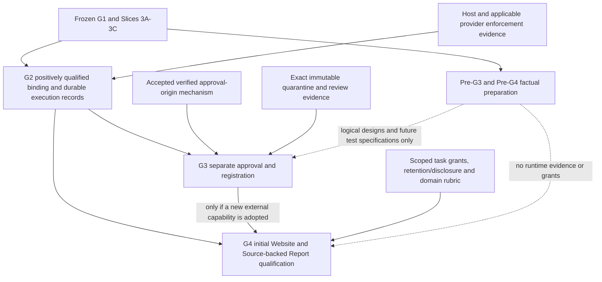

# Nexus Pre-G3 / Pre-G4 Dependency and Readiness Matrix v1

**READINESS CLASSIFICATION ONLY; not G3/G4 completion, acceptance or execution authority.**

## 1. Governing evidence and classification rules

The [factual reconstruction](nexus-pre-g3-pre-g4-roadmap-reconstruction-v1.md) binds the accepted Roadmap G3/G4, A0-A6, G1 and frozen quarantine/evaluation/applicability. Starting HEAD `d90fb15c7ede2b5764c825ed929bea4cf52beb50`. No dependency is invented from a filename or a generic agent architecture.

Dependency status uses exactly SATISFIED / CAN_PREPARE_NOW / CAN_DESIGN_NOW / BLOCKED_BY_G2 / BLOCKED_BY_G3 / BLOCKED_BY_PROVIDER / BLOCKED_BY_OWNER_DECISION / UNKNOWN. Work has exactly one primary A CAN_DO_NOW, B CAN_DESIGN_NOW, C BLOCKED_BY_G2, D BLOCKED_BY_G3, E OWNER_DECISION_REQUIRED or F UNKNOWN. Other blockers are referenced, not double-counted. SATISFIED identifies a narrowly available foundation, not a newly qualified execution path. Conditional provider/credential dependencies do not become universal requirements. UNKNOWN is never recoded as feasible merely to fill a plan.

## 2. Dependency graph

There is no G3 -> G2 dependency for the initial accepted-capability G2 workflow. No blanket G3 -> G4 dependency exists. G3/G4 runtime work can proceed independently only after their actual common G2 prerequisites and respective authority/evidence gates are met.

## 3. Evidence dependency register

| ID / dependency kind | Exact requirement and source | Current status / binding |
|---|---|---|
| D01 architecture | Accepted G3/G4 purpose and boundaries, Roadmap G3/G4/A3/A4 | SATISFIED for logical requirements only; reconstruction preserves definition gaps. |
| D02 foundation evidence | Frozen G1 data contracts and Slice 3A/3B/3C interfaces | SATISFIED as inspected source/frozen refs; no current Host qualification inferred. |
| D03 G2-derived durability | Durable approvals/revocations/projections and recovery facts use real G2 infrastructure; G3 6/12, A2 | BLOCKED_BY_G2. Names are not implemented durable APIs. |
| D04 Host/runtime observation | Positive complete binding, non-bypassable authority/resource/budget/cancellation/observation; G2/A2/A6 | BLOCKED_BY_G2. Positive Host Binding ABSENT. |
| D05 provider | Exact provider restrictions and exposure/tail evidence if chosen binding uses a provider | BLOCKED_BY_PROVIDER for that conditional route; no provider selected and no contact allowed. |
| D06 owner/trust | Verified approval-origin and protection from candidate/executor forgery; Roadmap H, G3 8/12/15 | BLOCKED_BY_OWNER_DECISION. Mechanism unknown; this task cannot accept a trust boundary. |
| D07 G3-internal evidence | Bind exact component/revision/tree/intake policy and relevant review evidence | CAN_DESIGN_NOW; immutable identities already exist, actual approved fixture does not. |
| D08 G3-internal ordering | Validate origin/scope/validity/revocation before bounded registration and current eligibility | CAN_DESIGN_NOW for evidence order only; implementation depends D03/D06. |
| D09 G4 directly on G2 | Actual workflow execution, ledger/recovery/cancellation/effect handling | BLOCKED_BY_G2 even when all capabilities were already accepted. |
| D10 G4 conditionally on G3 | Actual approval/registration/current eligibility for a newly adopted external component | BLOCKED_BY_G3 only for that adoption; no forged G3 results. |
| D11 credentials | Whether a selected identity/Host requires credentials and its qualified delivery mechanism | UNKNOWN, conditional. Credential possession never satisfies D06 or task authority. No value accessed. |
| D12 owner/data | Retention/disclosure recipients and periods before persistent real-data operation; Roadmap H/A4 | BLOCKED_BY_OWNER_DECISION for real data; no default duration or cross-project scope. |
| D13 domain evidence | Exact subjects, source-to-claim/consumer coverage, acceptance and reopen rubric | CAN_PREPARE_NOW for criteria/test specifications; actual real workflow evidence absent. |
| D14 external effects | Original operation, final observation, unresolved exposure/reconciliation before retry; A2/CP4 | BLOCKED_BY_G2 when an authorized workflow has effects; no effect assumed from a record. |
| D15 wire/storage interfaces | Full G3/G4 serialization/bounds/error semantics and concrete protected persistence surfaces | UNKNOWN; logical catalogs possible, runtime API/schema choices not silently selected. |
| D16 optional ecosystem | New source outside frozen intake policy or optional tooling/pack | BLOCKED_BY_OWNER_DECISION if pursued; not a minimum-product blocker or current implementation item. |

## 4. Exhaustive bounded work decomposition

These 32 items cover the accepted G3/G4 logical contracts, integration, evidence and explicit decisions at this roadmap granularity. They do not claim to enumerate future Host-specific implementation tasks. Primary categories are initial classifications; completing preparation does not reclassify blocked runtime work as PASS.

| Work ID | Meaningful item / requirement source | Primary category | Dependencies | Readiness completion or exact residual |
|---|---|---|---|---|
| W01 | Reconstruct eight G3 and eight G4 definition dimensions, Roadmap G3/G4 | A CAN_DO_NOW | D01/D02 | Completed in reconstruction; unresolved details explicitly retained. |
| W02 | Dependency graph, conditional G3 edge, classifications, Roadmap A/I | A CAN_DO_NOW | D01 | Completed here; no G2 assumption. |
| W03 | Frozen reuse/compatibility and anti-duplication inventory, A1/A3/A4 | A CAN_DO_NOW | D02 | Completed in reconstruction and later logical design; no existing interface edit. |
| W04 | Future acceptance gates and deterministic scenario oracles, G3/G4 9/10/16 | A CAN_DO_NOW | D01/D13 | Completed in contract/qualification design; not executed future G3/G4 tests. |
| W05 | Adversarial/scope/hash review and safe checkpoint, Roadmap B/G | A CAN_DO_NOW | W01-W04 | Completed in the final readiness review and verified checkpoint; no independent Host audit claim. |
| W06 | G3 three-record minimum field/evidence catalog, G3 7 | B CAN_DESIGN_NOW | D07/D15 | Logical design only; no issuer, wire version or authoritative object. |
| W07 | G3 approval/readback/projection/current eligibility interfaces, G3 4/8 | B CAN_DESIGN_NOW | D08/D06 | Specify evidence obligations; concrete protected channel/API unresolved. |
| W08 | G3 revocation, duplicate/partial write, restart and rollback expectations, G3 4/9/A2 | B CAN_DESIGN_NOW | D03/D08 | Design fail-closed recovery; no new journal/ledger implementation. |
| W09 | G4 five-record minimum field/evidence catalog, G4 7 | B CAN_DESIGN_NOW | D13/D15 | Logical catalog; no store, parser, graph or engine. |
| W10 | Context disclosure, confirmation, supersession, retention, G4 4/8/A4 | B CAN_DESIGN_NOW | D12/D15 | Evidence and invalidation design; no automatic confirmation/real-data persistence. |
| W11 | Typed relation and change-impact binding/coverage, G4 4/7/9 | B CAN_DESIGN_NOW | D13 | Design conservative missing-consumer handling; not universal code intelligence. |
| W12 | Website and Source-backed Report pack boundaries, G4 2/10/domain table | B CAN_DESIGN_NOW | D09/D13 | Prepare both logical pack rubrics; do not generate/run applications or reports. |
| W13 | G4 interruption, reduction, acceptance/stop/disable expectations, A2/A4/G4 10 | B CAN_DESIGN_NOW | D09/D14 | Design original-evidence preservation and effect-aware resume. |
| W14 | Implement actual G3 protected durable store/transitions, G3 6/12 | C BLOCKED_BY_G2 | D03/D06/D15 | No implementation; needs stable accepted G2 and origin. |
| W15 | Live G3 approval/registration/revocation controlled fixture, G3 10/16 | C BLOCKED_BY_G2 | D03/D06/D07 | No real approval issued; independently authenticated fixture required later. |
| W16 | Review-to-current-eligibility integration and drift race tests, G3 4/9 | C BLOCKED_BY_G2 | D03/D04/D08 | No dispatch or frozen routing mutation. |
| W17 | G3 interruption/replay/rollback runtime qualification, A2/G3 9 | C BLOCKED_BY_G2 | D03/D06 | No mock promoted to crash-consistency evidence. |
| W18 | G4 persistent context/decision/relationship/impact implementation, G4 6/12 | C BLOCKED_BY_G2 | D09/D12/D15 | No new memory platform or domain logic in planner core. |
| W19 | Real bounded Website workflow and consumer/browser/visual checks, G4 10/16 | C BLOCKED_BY_G2 | D04/D09/D13 | No website implementation, deployment or qualified runtime claim. |
| W20 | Real Source-backed Report workflow/source/calculation/render checks, G4 10/16 | C BLOCKED_BY_G2 | D04/D09/D13 | No retrieval, generated report or runtime qualification. |
| W21 | Domain cancellation/recovery/effect/budget fault qualification, A2/A6 | C BLOCKED_BY_G2 | D04/D09/D14 | No new timeout/refusal matrix counted as useful workflow success. |
| W22 | Real context privacy/recipient/compaction boundary tests, G4 8/A4 | C BLOCKED_BY_G2 | D04/D09/D12 | Child/model self-report not independent coverage. |
| W23 | Adopt a new external capability in either initial pack, G4 12/A3 | D BLOCKED_BY_G3 | D10 | Conditional only; already accepted capabilities avoid this dependency. |
| W24 | Use actual G3 approvals/revocations to invalidate a pack, G3 10/G4 9 | D BLOCKED_BY_G3 | D10/D08 | Interfaces can be designed; actual G3 outputs cannot be fabricated. |
| W25 | Select/accept independently authenticated approval-origin mechanism, Roadmap H/G3 15 | E OWNER_DECISION_REQUIRED | D06 | No creator-writable JSON/signing/broker shortcut selected. |
| W26 | Approve actual retention/disclosure rules for real data, Roadmap H | E OWNER_DECISION_REQUIRED | D12 | No invented default period/recipient. |
| W27 | Authorize actual stage execution and exact controlled qualification subjects, G3/G4 16 | E OWNER_DECISION_REQUIRED | D03/D09/D13 | Present authorization covers readiness only. |
| W28 | Lock comparative/task-specific materiality rubric before experiments, Roadmap F/H/A6 | E OWNER_DECISION_REQUIRED | D13 | No numeric benefit threshold invented. |
| W29 | Optional source-intake extension/extra pack adoption, Roadmap G3/source coverage/G4 11 | E OWNER_DECISION_REQUIRED | D16 | DEFERRED, excluded from minimum scope. |
| W30 | Exact G2 durable API/runtime consistency behavior usable by G3/G4 | F UNKNOWN | D03/D15 | Names known; implementation/conformance absent. No invented signatures. |
| W31 | Exact qualified Host identity/credential/context handoff mechanics | F UNKNOWN | D04/D11 | Binding-dependent; no provider abstraction or credential mechanism built. |
| W32 | Exact G3/G4 wire schema/version/bounds/storage compatibility | F UNKNOWN | D15 | Logical requirements prepared; serialized acceptance remains undefined. |

Initial totals: **A 5; B 8; C 9; D 2; E 5; F 3**. D05/D11 apply conditionally across the rows; they are not missing primary work classes. Source-side logical obligations are specified without assuming a provider, OS, approval credential or external effect.

## 5. Minimum autonomous readiness plan and finite exit

1. Complete W01/W02 and inspect the foundation reuse basis of W03 before further design. Preserve source/reference/manifest evidence for the bounded readiness checkpoint. This does not accept a successor architecture.
2. Complete W04 and the remaining W03 compatibility detail while designing W06-W13 in one bounded [contract/qualification design](nexus-pre-g3-pre-g4-contract-and-qualification-design-v1.md). Prepare only inert documentary scenarios with independent expected results; no implementation justified by unresolved wire/origin/runtime choices.
3. Complete W05 through a separate static/adversarial pass, applicable existing tests, protected-source/refs checks and a clean checkpoint. Review records completed preparation versus unchanged blocked rows; no fake future test execution.
4. Reassess once: if all A outputs and all useful B designs are complete, stop. Rows C/D need actual G2/G3; E needs separately accepted decisions; F lacks exact factual interfaces. Do not multiply packs, subjects, validators or summaries to keep working.

No standalone prototype is preselected. A pure data validator would currently duplicate frozen validators or freeze unsupported new schemas without answering approval origin, actual durability or Host evidence. Any later concrete unresolved design question must meet all local/offline/no-effects/no-credentials/no-authority/no-Host-dependency conditions before a prototype is warranted.

Preparation can finish requirements, logical catalogs and scenario oracles now. It cannot finish G3/G4, verify approval origin, manufacture task grants, qualify a Host or settle external effects. If authoritative human OpenAI support evidence arrives, preserve the next clean checkpoint and stop for separate G2 adjudication; do not mix it into these designs.

A0-A6/P1-P12 unchanged. Scenario 01-04 = NOT RUN; HQ1-HQ5 = NOT PASS; HQ6 = NOT STARTED; Positive Host Binding = ABSENT; G2 Runtime = HOLD; OpenAI human escalation = PENDING; G3/G4 NOT ENTERED. No provider/network/secret/cost, implementation of runtime/authorization/memory services, merge/push/tag/freeze.
