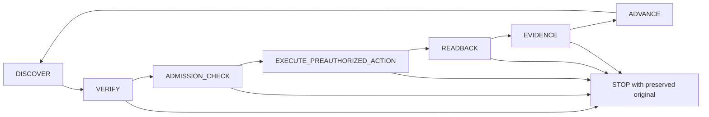

# Nexus Route D Autonomous Lab Orchestration v1

Policy ID: nexus.route-d.lab.bounded-autonomy.v1 | Proposed version: 1.0.0
Date: 2026-10-04 (Asia/Kuala_Lumpur)
Status: PROPOSED DOCUMENTARY DESIGN; NOT ACCEPTED, IMPLEMENTED, ACTIVE OR EXECUTION-READY.
Decision: **AUTONOMY_REQUIRES_NARROW_GOVERNANCE_AMENDMENT**.
Repository baseline: nexus-v2-g2-development / 8481fba34ce7c03cdc1839e8d823c0607fbe1069.

This package supplies all 17 requested design outputs. It supplies no grant, implementation, executable configuration, VM diagnosis or permission to resume P1. Its JSON documents describe prospective contracts, not runtime input. Source identities and checks are recorded in SOURCE-BINDINGS.json and PACKET-VALIDATION.json.

## 1. Architecture and controlling baseline

The goal is automatic progress through a finite, previously authorized list of operations while the Owner remains present. Autonomous progress does not imply unattended operation, automatic authority renewal, general task dispatch or a new attempt. Routine safe reads need no repeated approval once their enclosing exact policy/grant has actually been accepted. Each effect still consumes independently issued, action-specific authority.

Verified documentary facts: the accepted governance record incorporates applicability E01-E12; its acceptance grants governance scope only. E02 permits one attended session, one fixed harmless fixture and one original slot, and explicitly excludes general dispatch, models, Agents, MCP and delegation. E08/E10 and gates L2/L6 separate setup from fresh release, retain original exposure and forbid replacement/retry. The P1-P8 blueprint has separate O1-O8 approval scopes and unresolved exact native authorization, prerelease observation and numeric budgets. Its paths and resource targets are proposals, not effective controls. These facts are supported by source bindings S02-S07. Production control-plane/native-execution separation is supported by S09-S10.

The owner's current checkpoint is an input constraint, not a fresh VM observation: P1; Section 3 PARTIAL; boot binding UNKNOWN; Section 4 NOT STARTED; P2 NOT READY; U02-C / D2-C; G2 HOLD; Positive Host Binding ABSENT; D3 / D3-lab NOT AUTHORIZED. S08 records historical completed lookups and a pending, ambiguous console buffer. Nothing here refreshes that state or clears the Owner's latest stop.

Responsibility boundaries:

| Component | Responsibility | Prohibited responsibility |
| --- | --- | --- |
| Owner | Accept exact policy, finite per-action grants and concrete risk; remain present; decide boundary changes and fresh RELEASE | Implied release from design acceptance; treating sign-off as proof of cessation or qualification |
| Nexus governance layer | Validate independent authority, exact dependencies, original journal, reservations, bindings, evidence eligibility and stop reasons | Minting its own grants; implementing a generic agent loop, privileged broker, VM runtime or hard fence |
| Existing Work/computer-control surface | Under the proposed clarification, perform only enumerated external preparatory controls and readbacks with bounded input recovery; package records | General lab task/model/Agent/MCP dispatch, delegation, arbitrary code, guest input on an ambiguous channel or expanding authority |
| Reviewed fixed adapter/receiver, if separately implemented | Exact supported operations on held originals, strict framing/sequence/expiry and source-labelled observation | Shell/eval passthrough, dynamic unit arguments, root broker, fallback channels, credentials or auto-reconnect replay |
| Native Windows/VirtualBox/guest facilities | Actual native effects and supported inner enforcement under declared healthy assumptions | An inferred independent fence or qualified Host status |
| Protected journal/evidence and refusal consumers | Persist original reservations before dispatch; preserve source lineage, gaps and non-promotion | Success from missing receipts, finalization, artifact hashes or fixture-controlled flags |

Model interpretation cannot itself be the admission boundary. A future supported, reviewed gate must reject unauthorized tool paths, scripts, deferred calls and indirect execution before effects. Prompt instructions and after-the-fact traces are insufficient. If such a boundary cannot be established, effects remain refused; this design does not authorize building it.

## 2. Action classification matrix

AUTO means no per-operation question only after an accepted enclosing policy, exact scope, fresh relevant bindings and numeric budget. It is not current permission. PRE-AUTHORIZABLE means a separate exact action grant can be accepted before a batch; admission is rechecked immediately before each action. OWNER-ONLY means stop for the human decision, not that the proposed action becomes safe or allowed automatically after a yes.

| ID | Class | Operation | Admission / completion condition |
| --- | --- | --- | --- |
| A01 | AUTO | Read enumerated Host/VM/process status metadata | Offline status only, non-elevated actor, exact held VM/process association; no lifecycle verbs |
| A02 | AUTO | Read enumerated P1 guest metadata / fixed utility presence | Fresh boot and reliable prompt/control; ordinary nexus rights; no protected databases or arbitrary files |
| A03 | AUTO | Capture bounded source evidence and fixed preflight readbacks | Exact sources, no credential/private-value capture; storage reserve and custody adequate |
| A04 | AUTO | Validate file hashes/manifests and reconcile documents | Accepted file inventory, bounded bytes; no disk-image content reads; hashes prove equality only |
| A05 | AUTO | Recover UI focus/capture before input | Positively no queued/issued guest command or other effect; retry rules in section 5 |
| A06 | AUTO | Package results / advance through authorized dependencies | Complete receipt and immutable lineage; ADVANCE does not create authority or phase permission |
| A07 | AUTO | Refuse on contradiction/decisive UNKNOWN | Preserve original exposure and all stop causes; never mark completion or retry |
| E01 | PRE-AUTHORIZABLE | Create exact known-new directories | O2; full absence/parent/alias and object/capacity checks; no parent widening |
| E02 | PRE-AUTHORIZABLE | Apply exact ACL/mode on enumerated new objects | O2/O3; exact ACE/mode bytes and effective actor rights; no generic security-boundary change |
| E03 | PRE-AUTHORIZABLE | Create two fixed locked identities and their primary groups | O3; fresh unused IDs, exact root setup path; Work has no currently established root executor |
| E04 | PRE-AUTHORIZABLE | Deploy fixed inert reviewed artifacts/native policy | O4; exact bytes/dependencies/inverse; no enable/start/autostart, implementation or compilation implied |
| E05 | PRE-AUTHORIZABLE | Allocate fixed tmpfs/cgroup on approved new boot | O5 after P6b; actual native mechanism and aggregate limits known; no remount/reallocation |
| E06 | PRE-AUTHORIZABLE | Prepare exact UART fields/tty policy | O6a; positively powered off; unchanged unrelated VM/NIC fields; guest root separately scoped |
| E07 | PRE-AUTHORIZABLE | Create one held local named-pipe instance | O7a; reviewed server/peer/DACL/first-instance mechanism; no replacement/reconnect |
| E08 | PRE-AUTHORIZABLE | Start/stop exact original helpers | O7a/O7b and separate valid stop scope; no fixture release or generic process termination |
| E09 | PRE-AUTHORIZABLE | One orderly shutdown and one cold boot in original setup plan | O6a/O6b; exact old-to-new boot transition and issuer-approved rebind; never stall repair |
| O01 | OWNER-ONLY | Password/credential; new privilege; root outside exact accepted scope | Stop before access or elevation; no password collection, forwarding or attempt |
| O02 | OWNER-ONLY | New package, network reconnect/enable, provider/API access | Outside this policy; separate review, never automatic installation/fallback |
| O03 | OWNER-ONLY | Destructive removal, irreversible change, reset/force-off/snapshot/restore/save-state or unknown recovery | Not granted here; exact separate decision required; governance-forbidden actions require policy review too |
| O04 | OWNER-ONLY | Security-boundary/production-governance change; D3-lab RELEASE; positive production G2/HQ/Host Binding | Fresh independent decision; no lab-to-production promotion |
| O05 | OWNER-ONLY | Any decisive UNKNOWN identity/effect/budget or allowlist violation | Admission closed; request the missing decision/evidence without proposing a speculative effect |

Exact per-effect actors, proposed object locators, operations, ceilings, expiry, inverse/readbacks and invalidators are in ACTION-ENVELOPE-REGISTER.json. All effect records currently have admission REFUSED. Root operations remain Owner-console work until a supported exact noninteractive mechanism is separately reviewed and authorized; an envelope alone cannot invent that mechanism. Ordinary read-only commands need not be handed to the Owner when a safe authorized input path exists.

## 3. Exact authority envelope schema

AUTHORITY-ENVELOPE-SCHEMA.json defines the structural contract for a future fully bound grant. Additional properties are rejected. Unknown/null values cannot satisfy decisive fields. The registry deliberately retains UNKNOWN draft values; it is not a conforming grant. No example pretending to be an accepted runnable grant is supplied.

Mandatory binding groups: independently issued authority and exact accepted policy/exception hashes; purpose and non-promotion flags; one original/session and held process identity; VM UUID/config hash and current boot; exact actor/token/privilege; immutable operation/arguments and physical objects; sealed bytes/dependencies; UTC and original monotonic deadlines; complete numeric action/session reservations; attended condition; supported executor and evidence custody; independently issued stop/cleanup scopes and exact inverses.

The typed HOST_DIAGNOSTIC_ONLY branch explicitly records guest_boot_id=null as a fact not relied upon. It permits only A01/A03/A04/A06/A07 with the Windows actor and semantically Host-only objects; no guest input, focus manipulation or effect. It still requires fresh Host/VM association, exact accepted diagnostic authority and numeric reservation. The GUEST_BOOT_BOUND branch requires a known exact boot. Null in the Host-only branch cannot be used to claim guest readiness or qualify a future effect; missing Host association still refuses.

The schema is necessary but insufficient. Semantic admission MUST check: (1) real independent Owner acceptance and issuer identity, not a claimed string/signature; (2) exact action membership in the accepted policy and original journal, no wildcard/glob/argv interpolation; (3) full path/parent/alias/physical ID or known-absence binding, effective rights and no privileged widening; (4) current held processes, boot, config and bytes match fresh trusted readbacks; (5) UTC and monotonic origins/remaining limits are consistent and earliest expiry wins; (6) reservations fit all applicable original/issuer ceilings, including setup/helpers/copies/retention/prior exposure; (7) causal dependencies and readback/barrier precede every dependent effect; (8) actual enforcement and permanent non-promotion already exist; (9) exact supported operation rights are established; (10) no new original, replay, reconnect or authority renewal; (11) observed attendance is current; (12) excluded-fault UNKNOWN is used only for declared outer tails, never an inner prerequisite.

An approved vector can contain separately identifiable O2-O7 grants, each with its own exact bindings/expiry/inverse. It cannot grant unknown future UID/GID, ACL, executable, boot or amount. A future boot is never predicted: the cold-boot action can name its expected transition and postcondition, but the Owner must issue/review the resulting exact boot-bound grant before P5/P7b. This is a genuine binding decision, not routine transcription. RELEASE remains a separate fresh Owner decision.

## 4. Autonomous state machine

| State | Required work / allowed transition |
| --- | --- |
| DISCOVER | Recover checkpoint/grants/reservations and only accepted diagnostic scope. Current boot UNKNOWN allows Host-side diagnostic-only sub-scope, never guest input/effects. |
| VERIFY | Independently verify source, identity, bytes, observations, custody and omitted coverage. A harmless nondecisive omission is recorded; decisive UNKNOWN closes dependent admission. |
| ADMISSION_CHECK | Apply all semantic predicates; reserve original numeric resources and persist intent before dispatch; issue no new authority. |
| EXECUTE_PREAUTHORIZED_ACTION | Invoke one immutable operation once. No dynamic action selection or inferred retry. Preserve submission status, including UNKNOWN delivery. |
| READBACK | Independently read the exact postcondition and absence of forbidden collateral effects. Requested/applied/loaded/enforced are distinct. Missing readback is not permission to repeat. |
| EVIDENCE | Write bounded protected receipt linked to intent/grant/original/boot/bytes, preserve gaps/exposure and cumulative usage. Storage failure closes admission. |
| ADVANCE | Advance only satisfied dependencies with valid existing grants. Exhaustion means stop and package, not find more work. Current Section 4 stop cannot be overridden. |

Hard-stop labels: OWNER_REQUIRED (human boundary/decision); LAB_UNKNOWN (decisive evidence/effects unavailable); POLICY_EXPIRED (earliest expiry/revocation/attendance loss); BUDGET_EXCEEDED (projected or observed cap breach); IDENTITY_DRIFT; BOOT_DRIFT; CHANNEL_UNTRUSTED; ROLLBACK_REQUIRED. Persist the primary reason plus all concurrent causes. Every hard stop closes new-effect admission. Lab stop is not VM shutdown, fixture cessation, successful cleanup or settled cost.

Only already authorized, still-valid status/original stop/reconciliation may run in a stopped state. Cleanup requires independent valid cleanup authority and its predicates. No automatic transition out of a hard stop; Owner review of reconciled evidence and exact authority is required, without reusing a consumed/ambiguous slot. A diagnostic sub-scope may finish and package while effect admission remains closed.

## 5. Retry, recovery and the stall scenario

Proposed diagnostic limits, unaccepted: one assessment window at most 30,000 ms; at most 5 status queries; at most 3 process/CPU samples at 2,000 ms spacing; at most 3 screenshots; at most 65,536 bytes per textual response and 262,144 textual bytes aggregate; screenshots at most 2,097,152 bytes each and 6,291,456 bytes aggregate. All allocations/copies must also fit a separately completed actual U04/Host reserve. These caps limit work and captured payload under healthy assumptions; they do not bound kernel stalls, physical exposure, diagnostic process lifetime or Host cost through excluded faults. A blocking native query is not restarted or killed by a new termination mechanism; failure closes the assessment.

The three-image upper limit exceeds the older unaccepted 2,097,152-byte evidence target. It grants no enlargement: an accepted diagnostic scope must reconcile its exact selected capture count/size and all copies against a completed aggregate reserve; if the smaller target is retained, reduce the image budget or refuse. Process samples are obtained from one bounded collector invocation where supported, not uncounted per-sample probes. All native invocations count against the 5-query ceiling. No new collector/helper is created to make that possible.

Read retry is allowed only for one known pure/idempotent read where non-submission is proven, with at most 1 retry, counted within the same query/time/byte caps. Timeouts or unknown delivery require original status reconciliation, never duplicate process spawn or guest Enter. Effects/start/create/stop/lifecycle have 0 retries. Stop requests can also be ambiguous; no repeated signal is inferred. UI acquisition has at most 3 attempts within 10,000 ms, consuming the same enclosing window; every attempt requires a fresh view and proof no queued/issued input. Exhaustion is CHANNEL_UNTRUSTED, not an order for the Owner to type a routine command.

Future RCU/blank-console policy, applied here only as a static scenario:

1. Close guest input and new-effect admission immediately. Preserve the original buffer/delivery UNKNOWN and completed query receipts; do not repeat GID lookups. VM Running and active Host process are insufficient evidence of a responsive shell, same boot or cessation.
2. Within an already accepted diagnostic-only scope, ordinary non-elevated Windows status may read: exact VM native power/state and fixed config fields using the installed offline `showvminfo --machinereadable` status operation; held VirtualBox process PID/start/image/VM association; Host logical CPU count, two or three process CPU-time and working-set/thread-count samples; and passive console screenshots/window existence. Whitelist returned fields, avoid command lines/environments, disk contents, private values and unrelated processes. CPU deltas indicate sampled activity only, not a guest diagnosis. Native UUID plus process-name matching alone does not establish association. If exact association is unavailable, record UNKNOWN and do not attach to a guessed process.
3. Optional already existing kernel text may be read only if a separately accepted, exact, bounded, non-secret passive source is available. Do not discover by enabling a logger, serial helper, SSH, Guest Control, shell probe, benchmark or package. No input, Ctrl+L, Up, Enter, control sequence or soft-keyboard click is needed for this diagnostic path. A pending buffer UNKNOWN forbids the usual focus retry.
4. If passive observation shows a readable prompt, report `RECOVERY_OBSERVED; INPUT_CONTROL_UNVERIFIED; BOOT_BINDING_UNKNOWN` unless those latter facts are separately established. A visible prompt alone cannot prove reliable submission/echo/output or reconcile the old buffer. Stop for Owner review before any P1 resumption, as the present checkpoint explicitly requires. No READY probe is issued under this diagnostic-only envelope.
5. Mandatory intervention occurs immediately if the next necessary fact requires credentials/protected rights, an unaccepted channel or lifecycle/configuration action; otherwise at the first decisive contradiction, excluded-fault indication, cap exhaustion, or end of the 30-second assessment without sufficient recovery evidence. Package `OWNER ACTION REQUIRED`, exact observations and UNKNOWNs, reason, and the required decision: preserve/wait or separately review a specific recovery action. There is no automatically selected reboot/reset/poweroff. If a specific lifecycle action is later proposed, identify its exact original VM/action, prerequisites, risks/inverse limitations and why read-only assessment cannot establish recovery. A current exact repair cannot be named from this design scenario.

Recovery observation does not authorize resume. Repeated monitoring windows cannot replenish authority/budget or operate as an unattended automation. No lifecycle action is proposed or executed on the current VM.

## 6. Budget and expiry handling

Every grant needs numeric UTC not-before/expiry in epoch milliseconds; the original monotonic origin and absolute deadline; maximum action/phase/session elapsed milliseconds; original slot 1; retries 0 for effects; cumulative action counts, bytes/inodes/memory/tasks/CPU quota and period, capture/copy/storage/retention limits; priced cost and labor reserves in exact units; and remaining issuer ceilings after prior exposure. Currency uses integer minor units plus currency code, not floats or an invented historical allowance. A known zero component must have explicit source evidence; null does not mean zero.

Registry values are proposed inner ceilings inherited from the prerequisite blueprint or explicitly new unaccepted diagnostic/count/storage targets. They are not measured capacity, approved allowances or feasibility claims. Blueprint setup 5,000 ms, active 10,000 ms, stop-observation 2,000 ms and cleanup-observation 10,000 ms remain unaccepted. One combined setup ceiling is shared, not multiplied by nine action records. If shutdown/boot/preparation cannot fit it, admission refuses until the Owner accepts a revised fully reconciled numeric plan; automatic widening is forbidden.

Reservations include setup, helpers, VM/VMM/Windows/native overhead, all outputs/journal/temp/copies/metadata, Owner observation/labor and retained resources. Do not double-count overlapping ceilings as additional entitlement. Account attributable subtree and separately bounded overhead explicitly. Mandatory required total/absolute caps covering unresolved outer tails make execution inadmissible. `LAB_FAULT_COMPLETE_EXPOSURE=UNKNOWN_NOT_BOUNDED` is a permanent disclosure, not a number or waiver.

The earliest issuer/policy/operation UTC expiry, original monotonic deadline, phase cap, revocation, loss of attendance/observer/storage, binding drift or contradiction closes admission. No pause, clock reset, counter wrap, rounding extension, reconnect credit, renewed session, reused unused budget or automatic new grant. Proposed attendance source: direct local Owner availability confirmed at session admission and observed at intervals no longer than 5,000 ms; each check consumes approved budget and cannot itself create authority. The actual non-spoofable supported observation mechanism is UNKNOWN, so this is not release-ready. Loss of attendance closes immediately when observed; sampling does not guarantee continuous presence or an independent fence.

Stop/cleanup/status after expiry requires predeclared independently valid scopes with their own nonrenewing deadline and accounting, never a blanket emergency extension. Expiry cannot terminate an OS operation already in flight or make resource/cost exposure zero.

## 7. Evidence and readback

Persist before dispatch: independent grant reference, original slot/reservation, operation digest, held exact objects/process/boot/actor, expected precondition and inverse. Persist after dispatch: not-submitted/submitted/confirmed/UNKNOWN delivery, source capture order/time, exact postcondition and forbidden-change comparison, observed usage versus reserved amount, omissions/contradictions and remaining scope. Records carry parent intent, monotonic sequence, byte/hash identities, fixed non-promotion flags and trusted writer identity. Sequence wrap, replay, mismatch or missing protected intent stops admission.

Guest stdout is a guest observation, not independent custody or effective protection proof. UID lookup absence is not assignment/reservation; VM Running is not shell health; config hash is not live enforcement; a pipe name is not held peer identity; a stop request/deadline is not positive zero-live; a successful read is not Section 3 completion while login.defs remains missing. Shell input requires observed full immutable command, reliable prompt/echo and fresh relevant binding, with no unknown pending input; only the approved ordinary read scope may be submitted.

Protection is actual source-specific custody: workload cannot write authority/configuration/eligibility or evidence, readbacks are outside fixture write scope, records are capacity-bounded and protect decisive UNKNOWN. Windows/guest TCB and same-Owner trust remain explicit. Storage loss/capture truncation affecting a decisive fact stops; optional nondecisive facts can be DEFERRED with downstream dependency explicitly blocked. This artifact's output folder is documentary storage, not an implemented protected runtime journal.

## 8. Rollback policy

Inverse plans describe recovery; they never grant it. Capture exact before-existence, physical IDs, parents/aliases, owner/ACL/mode/bytes/native fields and live references BEFORE each action. Rollback is a separate admitted operation with an independent valid grant, fixed objects, numeric reserve/deadline, known original task cessation, and deterministic inverse. No rollback of evidence to hide partial effects.

On failure: close admission, preserve original/reservation, query only authorized originals, and set ROLLBACK_REQUIRED. Stop original helpers only with valid specific scope; normal exact unmount requires positive zero-task and mount identity; deactivate/remove inert objects or unused new identities only after known ownership/no-live proofs; restore exact UART/tty fields only while positively powered off with separately admitted field authority. Never force/lazy unmount, recursively delete, reuse UID, reboot to repair, restore snapshots or destroy VM/disk.

This v1 treats filesystem/identity deletion and other destructive inverses as OWNER-ONLY, even if the earlier setup blueprint described a possible inverse. Safe preservation/quarantine can be preauthorized only as exact reviewed non-destructive effects. Unknown identity/cessation/residue leaves originals retained and exposure UNKNOWN. Observation timeout is not cleanup success, and no fault-complete rollback time is claimed.

## 9. Owner interruption rules

Interrupt exactly once per consolidated boundary incident, with action/held original, verified facts, UNKNOWNs, grant/cap reason and the smallest decision required. Persist the incident; do not repeatedly ask for transcription or the same permission. Silence/new input is not approval. Mandatory triggers are:

1. Password or credential is required.
2. Privilege would increase beyond the accepted exact actor/operation scope.
3. Action or indirect effect is outside the allowlist.
4. Actor, held object, VM configuration, process or boot binding changed.
5. A destructive or irreversible effect is proposed.
6. Any projected or observed numeric cap would be exceeded.
7. A required decisive fact is missing, stale, contradictory or unprotected.
8. Recovery needs a lifecycle/configuration/channel change outside the exact envelope.
9. D3-lab RELEASE is next; a fresh Owner grant is required even with all readbacks ready.
10. Production G2/HQ/Positive Host Binding or governance could be affected.

Policy expiry/attendance loss fits triggers 3/7; stop and report. Nondecisive optional omissions do not force a question; record DEFERRED, and do not perform dependent actions. Ordinary transient UI acquisition before any input can use A05; ambiguous input or exhausted safe recovery becomes trigger 7/8. Protected metadata denial stays UNKNOWN; never try sudo/password first.

## 10. Boot and identity drift

Bind ordinary actor SID/token integrity/privilege, guest UID/GID and relevant rights, physical target/parent identity, VM UUID/config/disk metadata association, held process PID/start/image/token and guest boot ID. Historical locators guide what to inspect; they cannot discharge freshness. Freshness is a grant-defined numeric age and causal same-original ordering; name/PID/path equality alone is insufficient.

Unplanned reboot/changed boot closes all guest/effect grants: BOOT_DRIFT plus UNKNOWN residue/usage. Preserve the same original and cumulative reservation. Do not remount tmpfs, restart helpers, resume fixture, reconnect/replay or bind a new boot automatically. The sole planned cold boot requires the P6a/P7a/P6b dependency and an independently issued exact resulting boot grant before P5/P7b. If old/new boot evidence cannot be trusted, the transition is not complete. No additional attempt or expiry renewal results.

## 11. UI and computer-control ambiguity

Acquire a fresh view of the exact VM/window/soft keyboard and reconcile external human input before every prospective guest action. UI geometry and keyboard-capture state can change; cached coordinates are not proof. Focus retries only manipulate already existing approved focus/capture surfaces with no queued commands/effects; do not accept a dialog whose effect is unknown or change layout/configuration as a workaround.

Before submission, independently see the ordinary prompt, the exact entire allowlisted read and no stray pending characters; after submission, preserve source output/status. If partial input, Enter delivery or echo is UNKNOWN, stop input without pressing Up/Ctrl+L/Ctrl+C/Enter or retyping. Such keys can have guest effects and are not passive diagnostics. Safe reconciliation of a known editable buffer requires a separately accepted exact policy and reliable view; this current incident remains stopped for Owner review. Alternate SSH/Guest Control/serial helper, clipboard configuration, install, elevation and lifecycle are not focus recovery.

## 12. Non-promotion firewall

Before ANY setup effect, actual policy enforcement must isolate lab authority/dispatch/evidence consumers and enforce immutable `purpose=LAB_ONLY`, `qualification=false`, `positive_host_binding=false`, `production_g2_admissible=false`, `hq_pass_admissible=false`, accepted exact `engineering_exception_id`, `evidence_class=ENGINEERING_ONLY_NON_QUALIFYING`, and `production_qualification_binding_id=null`. Controller/receiver writes and every derived import/copy/summary/manifest must carry trusted source/original ancestry; fixture cannot set eligibility. Missing/invalid lineage closes admission rather than falling back to a label.

Mixed evidence remains tainted for positive qualification; naming, signing, hashes, Owner acceptance, healthy success or copying into production does not promote it. Negative lab observations may trigger investigation/STOP only. No HQ/binding IDs or production milestones are minted. Protected writer/storage/enforcing consumer mechanisms remain UNKNOWN and require separate review/implementation/readback. This package itself is permanently non-qualifying design evidence, not a qualification receipt.

## 13. P1-P8 compatibility

| Workstream | Future automation within exact accepted scope | Current blocker / preserved boundary |
| --- | --- | --- |
| P1 | Bounded ordinary metadata reads, preflight/evidence/reconciliation; safe focus recovery | Section 3 PARTIAL; pending buffer/control and boot UNKNOWN; Section 4 NOT STARTED and explicitly stopped. No current resume. |
| P2 | O2 exact new Windows roots/ACE application | P1 parent/absence/token/ACE/capacity unknown; firewall not enforced; P2 NOT READY. |
| P3 | O3 fixed locked identities through a proved exact executor | IDs not reserved/approved; root Owner-console setup remains manual; no password/sudo delegation. |
| P4 | O4 reviewed inert deployment/readback | Artifacts/dependencies and narrow manager authorization/prerelease barrier UNKNOWN; implementation/compiler authority absent. |
| P5 | O5 exact new-boot mount/cgroup setup/readback | Must follow P6b and new-boot grant; actual rights/quotas/aliases/aggregate U04 UNKNOWN. |
| P6 | O6a/O6b preplanned field-only UART and original orderly lifecycle | Positive off/known peer/TTY/inverse and exact lifecycle grants missing; never RCU-stall recovery. |
| P7 | O7a held server before cold boot; O7b original receiver/status after P5 | Code, peer rights, frame protocol and quotas UNKNOWN; no blanket root or reconnect fallback. |
| P8 | Assemble documentary protocol/readiness and refuse on missing facts | Actual U03 A-F/U04/firewall missing; distinct fresh RELEASE stays Owner-only. |

Correct order remains P1 -> SETUP_ADMISSION -> P2 -> P3 -> P4 -> P6a -> P7a -> P6b -> exact new-boot grant -> P5 -> P7b -> P8 -> separate Owner RELEASE decision. Numeric P1-P8 labels are prerequisite workstreams, not the production P1-P12 state graph. Automation changes neither dependency nor acceptance/evidence threshold. One attended original and no new paid/provider/network/credential effect remain fixed.

## 14. Governance changes required

The bounded read-only subset and separately issued exact setup grants are compatible with the existing authority model. Acceptance records require exact independent authority per action; they do not require a human to retype each safe read or confirm every operation in an already accepted vector. Routine grant batching therefore needs no relaxation. Unsupported mechanisms/numeric facts are readiness gaps, not a reason to weaken governance.

However E02's literal Agents/MCP exclusion makes external Nexus/Work autonomous orchestration ambiguous. We do not silently construe that exclusion away because Work already performed separately authorized P1 reads. The minimum required change is an explicitly accepted engineering-only scope clarification permitting the external fixed preparatory/readback controller, while preserving all restrictions on the lab execution unit and generic dispatch. This is a conservative governance decision, not a claim that all past Work interaction violated E02.

No production amendment, unattended model, new fence/runtime, privilege increase, retry, automatic boot rebind, release delegation or wider fault claim is necessary or proposed. If the Owner instead wants any of these expansions, this v1 does not support them and a separate governance/safety decision is required.

## 15. Can current governance support the whole model unchanged?

**Not as a fully explicit accepted contract.** E01/E03-E12 and the accepted authority architecture support its conservative bindings and limits, but E02 has no explicit exception for the requested external Agent-assisted automatic progression. The full model requires the narrow clarification below. This is distinct from runtime readiness: even after acceptance, effective gate/custody/channel/privilege/firewall/numeric evidence and exact executable grants remain absent. Current P1 permissions/stop cannot be expanded by this proposal.

Classification is AUTONOMY_REQUIRES_NARROW_GOVERNANCE_AMENDMENT, not a finding that bounded preparation inherently conflicts with the safety model. Scope incompatibility and implementation UNKNOWN are separately recorded.

## 16. Exact minimum proposed amendment

Proposed supplemental clause EO-AUTONOMY-01 (DOCUMENTARY PROPOSAL; not inserted into accepted documents):

> Solely for the existing NexusRouteDHost ENGINEERING_ONLY/LAB_ONLY route, E02's exclusion of Agents/MCP/general dispatch does not prohibit the existing external Nexus/Work control surface from advancing a finite, fixed, non-delegated list of preparatory operations and readbacks during the same Owner-attended original session. This exception applies only after Owner acceptance of the exact bounded-autonomy policy and independent, exact per-action grants, with supported pre-effect admission, current identity/boot/byte binding, complete numeric reservation, protected evidence and enforced permanent non-promotion. It does not admit any model, Agent, MCP, delegation or arbitrary-code workload inside the lab execution unit, general task dispatch, parallel work, a new generic runtime/privileged broker, unattended continuation, authority renewal, retry/replacement/resume or any weaker fallback. Safe no-input focus recovery and pure reads may run without per-operation confirmation only within their accepted exact scope and caps. Setup grants may be accepted together but remain independently identified and checked before each effect; UNKNOWN future fields cannot be granted. Fresh D3-lab RELEASE, new privilege, credentials, destructive/unknown lifecycle recovery, security-boundary and production-governance/qualification decisions remain Owner-only. E01 and E03-E12, all independent original/stop/cleanup authority requirements, fault disclosures, issuer ceilings and production prohibitions remain unchanged. Acceptance of this clause or design grants no implementation, configuration, current P1 resumption, P2-P8 effect or RELEASE authority.

No accepted source is edited. The complete original residual disclosure remains mandatory on every future grant/protocol/result; S02 section 5 is its exact hash-bound source. Its healthy assumptions and UNKNOWN duration/energy/cost tails are not replaced by this clause. If an applicable mandatory obligation requires a fault-complete finite cap, execution remains refused.

## 17. Exact next Owner decision

Decide whether to accept EO-AUTONOMY-01 and this v1 bounded-autonomy design **as documentary governance scope only**, preserving the current P1/boot/Section 4/P2 stop and granting no implementation, configuration, lifecycle, guest command or D3-lab RELEASE. If accepted, canonical integration would itself require separately stated documentary-recording scope; no accepted repository file is changed by this package.

After that decision, any possible P1 recovery assessment/resumption still needs its own exact approved scope and reconciliation of the latest Owner review stop. Do not bundle that with policy acceptance. P2-P8 effects require individually complete future grants and actual safety mechanisms. Missing scope/identity/effect/budget means STOP, not another broad permission question or an inferred grant.

Architecture, Security and Testing documentary challenge results are reconciled in DOCUMENTARY-REVIEW-v1.md. Static integrity/schema-design checks do not establish runtime conformance. Current preserved states and all positive-qualification exclusions remain unchanged.
