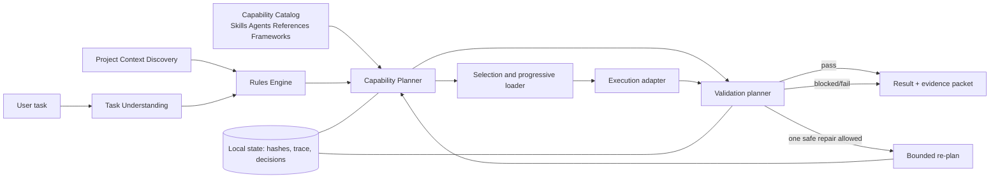

# Nexus V1.2 — Product and Architecture Specification

**Status:** Implemented V1.2 design reference — Nexus branding compatibility update
**Product identity:** Nexus — Adaptive AI Capability Hub (the user-facing name of Adaptive Skills Hub)
**Scope:** V1.2 planning only. No V1.1 runtime, test, registry, manifest, or tag is changed by this document.
**Baseline:** `v1.1-final` (`a09ac44c188ec59bd620734ae576f0f3c9b523e9`)

## 1. Executive summary

V1.2 evolves Nexus (the Adaptive Skills Hub system) from a deterministic skill recommender/loader into a bounded, evidence-producing **capability planner**. It should understand a task and its project, enforce repository rules before routing, use a deterministic greedy procedure to select the smallest sufficient set of compatible resources, load only those instructions progressively, plan validation before execution, and allow at most one safe repair/re-plan cycle.

The recommended design is **Option B: planner-centred, bounded orchestration**. It preserves V1.1's local-first, metadata-first discovery and actual `SKILL.md` loading, but adds explicit contracts, negative constraints, project-context discovery, plan evidence, validation planning, and traceable fallback. It does **not** introduce an autonomous multi-agent mesh, an external workflow engine, hidden retries, or a new dependency on DeerFlow.

V1.2 **must** provide a reliable explicit entry point, proposed as `hub.py plan "<task>"`. It can make Codex invocation more reliable when deliberately invoked or exposed through supported project instructions. It cannot by itself intercept every Codex request, nor cause ordinary ChatGPT Chat or ChatGPT Work to launch arbitrary local code. Those are runtime/product integration concerns and must remain explicitly conditional on documented platform support; their absence is not a V1.2 release blocker.

## 2. V1.1 baseline and immutability boundary

V1.1 remains frozen and usable as-is:

- local discovery is metadata-first;
- provenance and duplicate resolution are already present;
- routing is deterministic and can load the selected full `SKILL.md`;
- optional command hooks remain explicitly bounded;
- the final baseline is the `v1.1-final` Git tag.

V1.2 is additive. A future implementation must expose a separate `v2` entry point or explicit mode and must not change V1.1 selection, loading, state format, CLI behaviour, or regression baseline implicitly. A user must be able to run V1.1 after V1.2 code exists.

## 3. Product goals

### MUST HAVE

V1.2 shall:

1. Turn a user task into a typed task profile rather than a keyword bag.
2. Discover relevant project context progressively and within budgets.
3. Apply explicit project/user rules before capability selection.
4. Select the smallest sufficient compatible set of Skills and supporting references with a bounded deterministic greedy coverage algorithm.
5. Produce a machine-readable execution plan and a human-readable evidence packet.
6. Load actual selected `SKILL.md` files only after selection and record their hashes.
7. Plan validation before execution and support one bounded, policy-safe re-plan.
8. Preserve resource provenance, trust tier, execution compatibility, and duplicate decisions.
9. Make uncertainty, fallbacks, and platform limitations visible instead of inferring permission.
10. Provide the reliable explicit V1.2 planning entry point.

### SHOULD HAVE

- advisory Agent selection/recommendation, without Hub-controlled delegation;
- project-level opt-in Codex instruction integration;
- persistent local planning/evidence state;
- configurable context budgets and explicit cleanup controls.

### NOT IN V1.2

- embeddings, vector database, or general-purpose optimization solver;
- full multi-agent execution runtime or Hub-controlled Agent spawning;
- DeerFlow runtime dependency, GUI, cloud synchronization, or automatic Skill installation/updates;
- global always-on interception;
- ChatGPT Desktop, ChatGPT Chat, or ChatGPT Work automatic local Hub execution;
- automatic retention scheduler.

## 4. Non-goals

V1.2 shall not:

- modify or replace V1.1 by default;
- install, update, or copy Skills as part of ordinary routing;
- make unreviewed external references executable;
- turn every task into a multi-agent workflow;
- execute shell commands, network calls, writes, publishing, or Agent delegation without an explicit plan permission and runtime authority;
- promise background/automatic activation in products that do not expose a supported integration point;
- persist secrets, full prompt contents, or arbitrary project files in Hub state.

## 5. Product surfaces and user experience

The initial product is a **planning and evidence layer**, not a new chat UI. Its output is a compact plan packet, for example:

```text
Task profile: create_presentation / editable_pptx / medium risk
Selected: presentations (directly usable), ppt-master (directly usable)
Rejected: emil-design-eng (UI-only); untrusted external reference (not executable)
Rules applied: project presentation template required
Next load: exact selected SKILL.md files and template reference
Validation: open/render deck, inspect editable text and slide count
Fallback: native Codex slide workflow if selected tool is unavailable
```

The normal path must remain quiet: show the selected set, material exclusions, planned side effects, and validation. The complete trace is available on demand or on failure.

## 6. Architecture alternatives

| Option | Shape | Strength | Main cost/risk | Decision |
|---|---|---|---|---|
| A. Incremental router | Improve V1.1 scores and add a few exclusions | Lowest implementation cost | Still conflates ranking with decision-making; weak project context and repair evidence | Not recommended |
| B. Planner-centred bounded orchestration | Typed task/profile → rules → capability plan → progressive loading → execution/validation adapters | Clear contracts, explainability, controlled growth, works without external orchestration | More schemas and tests than A | **Recommended** |
| C. Full orchestration platform | Long-lived orchestrator, subagents, shared state, evaluators, queues | Useful for long-running multi-party jobs | Premature operational/security complexity; conflicts with local lightweight Hub objective | Deferred to V1.3+ or later |

## 7. Recommended architecture

Choose Option B. Its topology is deliberately linear with limited decision branches; it is not a peer mesh.



Every arrow carries a versioned structured object. Narrative model output may explain a decision but must not be the only representation of the decision.

## 8. Component responsibilities and contracts

| Component | Receives | Produces | Explicitly does not do |
|---|---|---|---|
| Task Understanding | user task, declared constraints | schema-valid `TaskProfile` | load Skills or execute tools |
| Project Context Discovery | workspace root, budget | `ProjectContext` + evidence | read an unbounded repository |
| Rules Engine | profile, context | ordered `RuleDecision[]` | invent project rules |
| Capability Planner | catalog, profile, rules | `CapabilityPlan` | execute a Skill |
| Progressive Loader | selected resource IDs | `LoadedResource[]` hashes/instructions | promote an unselected candidate |
| Execution Adapter | approved plan | `ExecutionResult` | grant unavailable runtime permissions |
| Validation Planner/Runner | plan, result | `ValidationResult` | silently accept unverifiable work |
| Re-plan Controller | failed validation | one amended plan or terminal outcome | loop indefinitely |
| Evidence Recorder | all structured decisions | redacted trace/packet | store secrets or full file contents |

## 9. Task Understanding

`TaskProfile` is the routing contract. The primary task-understanding authority is **Codex structured semantic extraction**: Codex produces a `TaskProfile` conforming to a versioned JSON schema. Its schema should include:

```json
{
  "schema_version": "2.0",
  "task_id": "uuid",
  "intent": "create | modify | analyse | research | review | operate",
  "deliverables": [{"type": "pptx", "editable": true}],
  "domains": ["business", "presentation"],
  "operations": ["author", "render", "validate"],
  "constraints": {"offline": false, "no_install": true, "no_external_write": true},
  "risk": "low | medium | high",
  "ambiguities": [],
  "confidence": 0.0
}
```

The deterministic layer is not a second, equal task-understanding engine. It validates JSON/schema shape, enforces hard constraints and rule-derived invariants, provides a conservative minimal parser only when Codex structured extraction is unavailable or invalid, and records audit evidence. If semantic extraction conflicts with a hard rule or deterministic constraint, the constraint wins; the planner either corrects the profile to the constrained form with evidence or returns a blocker when the conflict changes authority, side effects, or the requested deliverable. Ambiguity that changes side effects, data access, or authority pauses planning for clarification; ordinary ambiguity yields a conservative plan and visible assumption.

## 10. Project Context Discovery

Discovery is progressive, read-only by default, and evidence-bearing:

1. **Tier 0 — root facts:** root path, Git status, top-level names, platform/runtime facts.
2. **Tier 1 — governing instructions:** nearest applicable `AGENTS.md`, `SKILL.md`, project manifest, documented policies; initial soft budget of 8 files / 64 KiB.
3. **Tier 2 — task-local evidence:** selected target paths, package manifest, test configuration, template directories; initial soft budget of 20 files / 256 KiB.
4. **Tier 3 — expansion:** only on a typed evidence request, with an explicit reason, per-category cap, and trace entry.

The listed budgets are soft defaults, not rigid product contracts. A configurable hard ceiling limits every run. Reasoned expansion is allowed only when governing instructions are incomplete, a task spans multiple relevant modules, or dependency/configuration/test evidence requires more context; each expansion records the requirement, bytes/files added, and decision evidence. The Hub still avoids repository-wide scans by default. The context object records every path read, its content hash, why it was read, and whether it is trusted instruction, ordinary project content, or untrusted input. If required context cannot fit the configured hard ceiling without losing a required field, the Hub must report `context_budget_exceeded`; it must not silently truncate.

## 11. Rules Engine

Rules are evaluated before ranking and are represented as data, not scattered conditionals. Precedence is:

1. platform safety/permission policy;
2. explicit user request for scope, exclusions, or approval;
3. nearest applicable project instructions;
4. project manifest and compatibility declarations;
5. maintained local-source policy;
6. Hub defaults.

Rules can require, prohibit, cap, or annotate a resource. Examples: `require_editable_pptx`, `prohibit_network`, `must_run_tests`, `explicit_only`, `reference_only`, and `max_selected_skills=2`. Conflicts fail closed with a concise conflict report showing both sources and precedence.

## 12. Capability Planner

The planner forms a directed acyclic plan, not a flat ranked list:

```text
Task requirement
  └─ capability: editable presentation
       ├─ direct Skill: presentations
       ├─ optional enhancement: ppt-master
       └─ validation: render/open/readback
```

Each plan node has `requirement_id`, `resource_id`, `role` (`primary`, `supporting`, `validator`, `reference`), `compatibility`, `trust`, `load_phase`, `reason`, `cost`, `side_effects`, and `fallback_ids`. A candidate cannot enter the selected set solely because it shares generic words such as “skill”, “architecture”, or “AI”.

## 13. Resource model and provenance

The unified catalog contains four distinct resource kinds:

| Kind | Can guide execution? | Can execute directly? | Default treatment |
|---|---:|---:|---|
| Skill | Yes | Only if compatible and tools exist | selectable/loadable |
| Agent | Yes, as advisory specialist guidance | No Hub-controlled execution in V1.2 | recommend/record only; surrounding runtime may independently provide a mechanism |
| Reference | Yes | No | read only when materially needed |
| Framework | Architectural pattern/dependency candidate | No by discovery | reference-only unless separately adopted |

Every entry must retain `source_scope`, `source_uri_or_path`, `content_hash`, `license_when_known`, `execution_compatibility`, `trust_tier`, `duplicate_group`, `canonical_resource_id`, and `last_scanned_at`. Suggested source scopes are `project-specific`, `local-maintained`, `codex-user`, `codex-project`, `chatgpt-desktop`, and `external-upstream`.

## 14. Ranking and selection algorithm V2

V1.2 does **not** implement a general-purpose set-cover or optimization engine. It uses the following bounded deterministic coverage algorithm over validated candidates:

1. **Hard filters:** remove unavailable, incompatible, prohibited, shadowed, unsafe, and reference-only candidates.
2. **Required capability coverage:** derive the hard deliverable and operation requirements from the schema-valid `TaskProfile` and applicable rules.
3. **Deterministic scoring:** score candidates using exact capability coverage, TaskProfile relevance, project-rule compatibility, artifact match, negative evidence, runtime compatibility, trust/provenance, specificity, execution cost, overlap/redundancy, and previous validation status.
4. **Greedy minimal-sufficient selection:** start with no resource; repeatedly add the highest-scoring eligible candidate that covers an uncovered required capability. Prefer one primary Skill; add a supporting resource only for an independently uncovered requirement.
5. **Redundancy elimination:** remove each selected candidate whose removal preserves all required coverage and does not remove a required validator or rule-mandated resource.
6. **Evidence:** record the coverage contribution, score signals, and selected/rejected reason for every material candidate.

Codex structured extraction supplies semantic understanding; deterministic constraints, scoring, and this greedy algorithm provide validation, auditability, and conservative fallback. General optimization is deferred until scale benchmarks demonstrate a real need.

## 15. V1.1 routing observation and V2 correction

During design validation, the actual V1.1 command for a V1.2 architecture request discovered and fully loaded `skill-creator` and `skill-installer`. Its ranked candidates also included the more task-specific `evidence-first-research` near the top. That outcome is evidence of a decision gap: generic lexical overlap can influence the selected set even when a candidate is not the smallest sufficient resource for the requested artifact.

V1.2 addresses this by separating candidate ranking from coverage selection, introducing task operation/deliverable constraints, and recording negative reasons such as `not_creating_or_installing_a_skill`. It does **not** retroactively change V1.1.

## 16. Scale strategy: 30, 100, 500, and 1,000 Skills

| Catalog size | Required design | Avoid |
|---:|---|---|
| 30 | deterministic in-memory ranking plus greedy coverage selection | embeddings, queues, multi-agent runtime |
| 100 | cached catalog, capability/operation inverted indexes, duplicate groups, golden route tests | full text of every Skill in context |
| 500 | incremental scans, taxonomy versioning, filter-first / partitioned retrieval, trace sampling | O(n) full instruction loading |
| 1,000+ | optional hybrid retrieval only after measured false-negative/latency evidence; background catalog refresh only if runtime-authorized | automatic external installation or unverifiable semantic promotion |

At every scale, metadata discovery remains cheap and full `SKILL.md` content is loaded only for the selected plan. A vector index is a future optimization, not a V1.2 premise; if added it is an assistive retrieval candidate generator, never the authority for permission or compatibility.

## 17. Progressive loading and context budgets

The loader has three phases:

1. **Catalog phase:** names, concise descriptions, provenance, declared capabilities, hashes, and compatibility only.
2. **Plan phase:** selected metadata plus direct dependencies, exact rule evidence, and validation requirements.
3. **Execution phase:** full actual `SKILL.md` for selected directly usable Skills; a linked reference section only when the selected Skill says it is needed.

Initial soft defaults should be configurable per run: 24 KiB catalog summary exposed to reasoning, 64 KiB selected instructions, and 32 KiB project evidence. A separately configurable hard ceiling prevents unbounded expansion. A reasoned expansion is allowed when mandatory context would otherwise be missing; it must be recorded in decision evidence. The Hub stops with an explicit result before mandatory data would be lost, rather than silently truncating. The trace records all resulting load sizes and any compaction, but never logs secret-bearing instructions verbatim.

## 18. Plan and execution data structures

`CapabilityPlan` should be versioned JSON and include:

```json
{
  "plan_id": "uuid",
  "task_profile_hash": "sha256",
  "context_hashes": ["sha256"],
  "rules_applied": [{"id": "no-install", "effect": "prohibit"}],
  "requirements": [],
  "selected": [],
  "rejected": [],
  "load_order": [],
  "execution_steps": [],
  "validation_steps": [],
  "fallbacks": [],
  "side_effect_budget": {"file_writes": 0, "network": false, "external_publish": false}
}
```

`LoadedResource` additionally records canonical path, content hash, bytes loaded, and instruction phase. `ExecutionResult` and `ValidationResult` are separate typed records; validation must never infer success merely because a file exists.

## 19. Validation Planner

Validation is chosen by deliverable and risk before execution:

| Deliverable/task | Minimum validation |
|---|---|
| code change | targeted test/lint/type check plus diff review |
| editable PPTX | open/readback plus render/visual inspection where layout matters |
| document/PDF | render and inspect critical pages; verify editable/source requirement separately |
| research/architecture | claim/evidence ledger, source authority, internal consistency and explicit unknowns |
| routing decision | selected `SKILL.md` hash, coverage, exclusions, compatibility, and no duplicate load |

Each validator declares prerequisites, no-side-effect status, expected evidence, and failure classification. A validator unavailable in the current runtime yields `unvalidated` rather than a false pass.

## 20. Bounded re-plan and repair loop

The V2 state machine is:

```text
PLANNED → LOADED → EXECUTING → VALIDATING → SUCCEEDED
                                  └→ REPLAN_ONCE → EXECUTING
                                  └→ BLOCKED | FAILED | UNVALIDATED
```

Validation failures are classified as `implementation_defect`, `wrong_resource`, `missing_capability`, `dependency_failure`, `bad_plan`, or `project_rule_conflict`. Only `wrong_resource`, `missing_capability`, or `bad_plan` may trigger re-planning, and only when the evidence shows that the remedy requires a planning change rather than execution repair or a blocked dependency. The controller permits one re-plan per `task_id`; it must preserve the previous plan and explain the changed assumption. No re-plan may widen side effects, add an untrusted resource, or turn advisory Agent guidance into execution. After the single re-plan, the result is a native Codex fallback where applicable, an explicit blocker, or an honest failure report. Loops, silent fallback, and “try until it works” are prohibited.

## 21. State, memory, privacy, and retention

V2 state, when enabled, is local, versioned, and minimized. It may store the latest plans, evidence packets, plan IDs, timestamps, resource/path hashes, compatibility/provenance snapshots, rule IDs, selected/rejected IDs, validation status, bounded error codes, and user-approved decisions. It does not store API keys, tokens, credentials, full source files, full prompt transcripts, or raw external documents.

Persistent state is a SHOULD HAVE, not an acceptance prerequisite. V1.2 should support explicit cleanup controls and a `--no-state` mode that keeps only in-memory execution evidence. Retention concepts such as 30 days for completed trace summaries and 7 days for failed diagnostics may inform a future policy, but V1.2 does not require an automatic cleanup/retention scheduler. Any future shared/remote store needs a separately approved privacy and access-control design.

## 22. Trust model and permission boundaries

Trust affects eligibility and permissions, not only rank:

| Tier | Typical source | Default execution treatment |
|---|---|---|
| T1 managed/project | verified project rule or maintained local Skill | eligible after compatibility check |
| T2 local user | user-installed Codex Skill | eligible, record provenance |
| T3 official exposed application | documented, readable app-managed package | reference/adapter pending compatibility |
| T4 upstream external | repository/source reference | reference-only until explicit install/review |
| T5 untrusted content | web page, user upload, generated text | data only; never instructions or executable policy |

External content is isolated from Hub instructions. Instruction-like text inside repositories, web pages, or uploaded files is treated as untrusted data unless it is a recognized, in-scope governing file at an approved trust tier.

## 23. Threat model and mitigations

| Threat / abuse path | Impact | V2 mitigation |
|---|---|---|
| prompt injection in a README, web page, or reference | tool misuse / plan corruption | trust labeling, data/instruction separation, schemas, no automatic promotion |
| malicious or altered Skill | arbitrary command/data access | hash, provenance, compatibility, permission gate, no install during route |
| duplicate/typosquatted Skill | wrong instruction authority | canonical duplicate group and explicit authority precedence |
| broad project scan | leakage/context poisoning | progressive read budgets, path evidence, secret exclusion |
| shell hook escalation | local damage | side-effect budget, explicit approval, compatible-tool check, no inherited authority |
| re-plan loop | cost/latency/non-determinism | one-replan cap, terminal states, trace |
| state-file disclosure | privacy breach | redaction, hashes rather than content, retention limits |
| Agent guidance conflicting with project rules | plan corruption / unintended delegation | advisory-only Agent model, Rules Engine precedence, no implicit spawn, blocking approval for irreversible actions |

High-impact or irreversible actions (publishing, external sends, destructive changes, credential access, new dependencies) require a blocking approval gate even if a selected Skill recommends them.

## 24. Observability and evidence packet

Every run gets a `trace_id`. Each stage emits structured events containing elapsed time, input/output hash, rule IDs, candidate/selected IDs, byte budgets, tool/side-effect class, status, and error code. The packet contains:

- task/profile summary and assumptions;
- context paths read and hashes;
- capabilities detected;
- candidate, selected, and rejected resources with reasons;
- exact selected `SKILL.md` paths and hashes;
- rules and trust decisions;
- execution and validation evidence;
- fallback/re-plan reason if any;
- final status: `succeeded`, `failed`, `blocked`, or `unvalidated`.

Observability must be sufficient to trace a bad answer to a planner decision, context input, loaded resource, or validation failure without recording sensitive prompt/file content.

## 25. Failure, fallback, and human escalation

Fallback order is: selected compatible resource → narrower compatible resource or native Codex capability → structured blocked/unvalidated result → human decision. The Hub must state which stage failed and why. It must not substitute a different application runtime, install a package, contact a remote service, or broaden file access as a hidden fallback.

Human escalation is required for rule conflict, missing required authority, ambiguous high-risk intent, irrecoverable validation failure, trust downgrade, and external/platform capability needed for a requested integration. Advisory Agent guidance can inform that escalation but cannot supersede project rules or authorize execution.

## 26. Auto-activation strategy and real platform boundaries

| Surface | V2 classification | V2 can implement | Requires runtime/product support |
|---|---|---|---|
| Codex explicit | **MUST** | reliable `hub.py plan "<task>"` entry point and deterministic plan artifact | local shell/files exposed by the active Codex runtime |
| Codex project | **SHOULD** | project-local opt-in instructions that recommend/trigger the explicit plan path | the runtime must read project instructions and expose the entry point |
| Codex global | **DEFERRED / EXTERNAL** | none beyond portable artifacts | user configuration and a runtime-supported interception mechanism |
| ChatGPT Chat | **DEFERRED / EXTERNAL** | portable plan artifact and user-invoked workflow when available | a documented local execution, plugin, MCP, or Skills integration point |
| ChatGPT Work | **DEFERRED / EXTERNAL** | portable plan/evidence format for files and deliverables | Work must expose required Skills/plugins/connectors and local/project access |

Public OpenAI documentation presents ChatGPT Chat, ChatGPT Work, and Codex as differentiated workflows and documents Codex Skills/plugins/extension points; it does not justify assuming that ordinary ChatGPT Chat or Work automatically runs an arbitrary local Hub executable. See [OpenAI Developers](https://developers.openai.com/) and [ChatGPT use cases](https://learn.chatgpt.com/use-cases). V2 therefore treats cross-surface auto-activation as a capability negotiation, not a feature it can fabricate. Platform-level auto-activation is not a V1.2 acceptance blocker.

## 27. ChatGPT desktop/application resource integration

V2 retains the V1.1 principle: discovery is not execution compatibility. A future `chatgpt-desktop` adapter may index only readable, clearly identified Skill definitions/manifests exposed by the application, preserving their path, hash, application version, source scope, and compatibility classification. It must never reverse engineer binaries, read credentials/caches as Skills, or modify application directories.

Classification is one of `directly_usable_by_codex`, `adaptable`, `reference_only`, or `incompatible_unavailable`. Only the first may be selected for direct instruction loading, and only when the active Codex runtime has every required tool. Application-managed content is not copied unless licensing, integrity, and update behaviour are separately understood.

## 28. DeerFlow and external-framework position

DeerFlow is useful as a **reference**, not a V2 dependency. Its documented progressive Skill loading, clear distinction between enabled discovery and active use, bounded continuation, and explicit tool-policy concerns reinforce V2's staged loading, state machine, and side-effect boundaries. Its long-horizon sandbox/subagent harness, gateway, and multi-user runtime are materially broader than this Hub's needs and are therefore out of scope. See the [DeerFlow repository](https://github.com/bytedance/deer-flow).

No DeerFlow process, package, environment variable, network listener, or skill installer is added by V2. The same applies to any other external framework until a separate dependency decision is approved. Full Agent delegation/orchestration is deferred to V1.3+ unless a future platform capability makes it trivial, bounded, and safe.

## 29. Migration and compatibility plan

Future implementation phases should be additive:

1. Define versioned schemas and fixtures without touching V1.1 route results.
2. Add the reliable explicit `hub.py plan "<task>"` entry point with read-only `TaskProfile`, `ProjectContext`, and `RuleDecision` modules.
3. Add the constrained deterministic planner and packet output; compare its plans with V1.1 but do not replace V1.1.
4. Add progressive loading/validation adapters in V2 only.
5. Add the maximum-one re-plan controller after evaluator tests pass.
6. Consider opt-in project activation instructions only after the explicit command is stable; do not make them a release prerequisite.

Candidate modules: `ash/task_understanding.py`, `ash/project_context.py`, `ash/rules.py`, `ash/capability_planner.py`, `ash/plan.py`, `ash/validation.py`, `ash/replanning.py`, and `ash/evidence.py`. This is a proposed seam list, not a file-change authorization.

## 30. Test and evaluation strategy

V2 requires fixtures and independent acceptance tests before default use:

- at least 20 representative route cases spanning office artifacts, coding, UI, research, irrelevant-skill rejection, duplicate resolution, and no-match fallback;
- schema/contract tests for every stage;
- golden plan tests for deterministic inputs;
- adversarial tests for injected repository text, misleading generic terms, unavailable tools, and shadowed Skills;
- budget tests proving no full-catalog instruction load, soft-budget expansion evidence, configured hard-ceiling enforcement, and no silent required-context truncation;
- validation tests proving a file's existence alone cannot pass;
- re-plan tests proving one-loop maximum and no side-effect expansion;
- V1.1 regression suite run unchanged against the frozen baseline.

Quality gates should record selection precision, missed-required-capability rate, duplicate-load rate, full-instruction bytes per run, unvalidated-result rate, re-plan rate, and user escalation rate. The test set must prove the hard-filter → coverage → deterministic scoring → greedy minimal selection → redundancy-elimination sequence. Do not introduce embeddings or an LLM scoring dependency until a deterministic baseline, scale benchmark, and failure corpus justify them.

## 31. V1.2 acceptance criteria

V1.2 is ready for release only if it proves all of the following:

1. V1.1 tests and observed route behaviour remain unchanged in V1.1 mode.
2. A plan identifies task requirements, governing rules, selected/rejected resources, provenance, and exact loaded instruction hashes.
3. Generic lexical matches cannot displace a required, more precise capability without a documented rule.
4. Selection follows hard filters, required capability coverage, deterministic scoring, greedy minimal-sufficient selection, and redundancy elimination; it contains no duplicate canonical resource.
5. Full `SKILL.md` loading occurs only for actual selected, compatible Skills.
6. Validation is planned before execution and yields evidence or `unvalidated`.
7. Re-planning is bounded and cannot widen side effects or authority.
8. Untrusted/external content cannot become executable instruction through discovery.
9. The reliable explicit `hub.py plan "<task>"` entry point is live-tested; absence of platform-level auto-activation does not fail V1.2 acceptance.
10. Platform adapters report unsupported activation honestly, while project-level Codex activation remains opt-in/SHOULD HAVE.
11. Live tests cover Codex task execution and only claim ChatGPT Chat/Work integration where the active product actually exposes it.

## 32. Open decisions and recommendation

Approve Option B and keep V1.2 scoped to a local, opt-in capability planner. The first implementation decision should be the exact `TaskProfile` / `CapabilityPlan` JSON schema, the explicit `hub.py plan "<task>"` contract, and a 20+ case route fixture set including the observed generic-skill misselection. Use Codex semantic extraction as the primary task-understanding authority, validated by deterministic constraints and conservative fallback. Do not start a full multi-agent platform, a vector database, a general optimization solver, or cross-product automatic activation until measured need and documented runtime support exist.

Open decisions for review:

- exact default context-byte budgets for this repository;
- exact schema/error contract for unavailable or invalid Codex structured extraction;
- retention policy and opt-out UX for plan traces, if persistent state is enabled;
- which future project instruction mechanism activates `v2 plan` by default;
- which officially supported ChatGPT integration surface, if any, can invoke a local Hub safely.

---

## Source-use record for this design

### Actually used

- **Adaptive Skills Hub V1.1 `SKILL.md`** — applied its distinctions between Skill, Agent, Reference, and Framework; its progressive selected-Skill loading model anchors Sections 13 and 17.
- **`evidence-first-research` Skill** — applied its evidence-ledger discipline: verified platform facts are separated from design inferences and unsupported integration claims are marked as limitations.
- **`security-threat-model` Skill** — applied its assets/boundaries/abuse-path method in Sections 22–23.
- **`engineering-multi-agent-systems-architect` Agent guidance** — applied its contract-first topology, context budgets, least privilege, bounded recovery, traceability, and evaluator-loop cautions; this is why Option B is bounded rather than a mesh/orchestrator platform.
- **`openai-docs` Skill and official OpenAI documentation** — used to verify the differentiated ChatGPT Chat/Work/Codex surface and documented extension categories before setting the platform boundary in Section 26.
- **`bytedance/deer-flow`** — inspected as a framework reference; adapted only progressive loading and bounded continuation/policy concepts in Section 28, without adopting it.

### Considered but not used

- **`msitarzewski/agency-agents` / `jnMetaCode/agency-agents-zh` upstream repositories** — the locally available multi-agent architecture guidance covered the required design concerns; loading a duplicate upstream Agent would not improve this specification.
- **`Shubhamsaboo/awesome-llm-apps`** — example applications do not establish this project's capability, permission, or product-runtime contracts.
- **`emilkowalski/skills`** — its UI/design focus is not material to this non-UI planner specification.

### Not relevant

- **`rdev/liquid-glass-react`** — no React or Liquid Glass interface is being designed or built in this scope.
